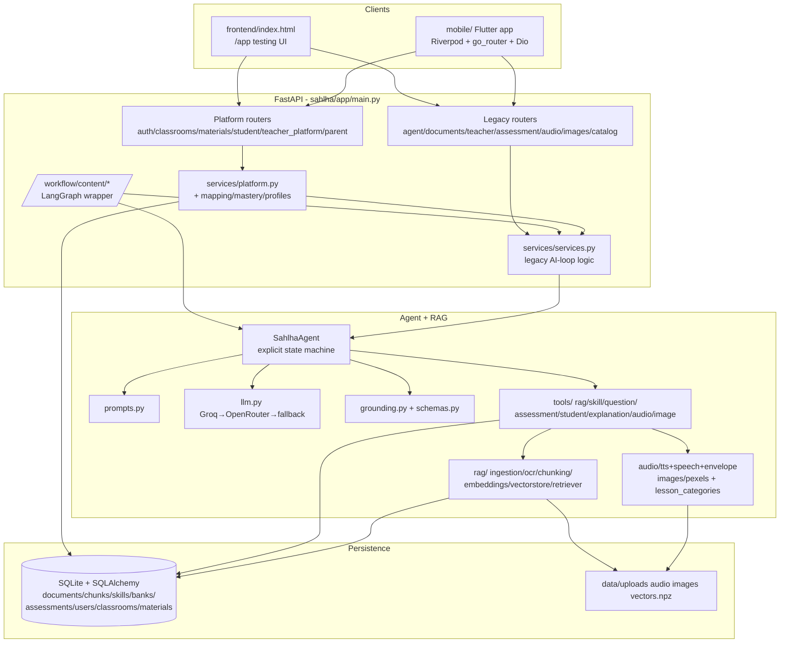
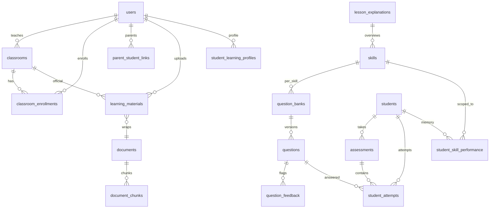

# Sahlha Architecture Overview

> Source of truth: the current codebase at the project root. All file paths are
> relative to the repo root. Class/function/module names are exact so a developer
> can jump from this document to the code.

## 1. System Overview

### What Sahlha currently does

Sahlha is an AI-assisted K-12-style learning platform with a human-in-the-loop
teacher workflow:

1. A **teacher (or parent)** uploads lesson material (PDF/DOCX/TXT/MD/image).
2. The backend ingests it into **RAG** (OCR → chunking → embeddings → vector cache).
3. The **agent** (`SahlhaAgent`) splits the lesson into **skills** (grounded topics),
   writes a **lesson overview explanation** plus one **per-skill explanation**, and
   generates **one question bank per skill** (default 8–10 MCQs each).
4. A **teacher reviews** each bank: approve / reject (with feedback) / edit /
   regenerate / flag individual questions. Only **approved** questions ever reach
   students, and only the **latest approved version per skill** is used for new
   assessments (older approved versions are preserved as history).
5. A **student** studies the lesson overview + skill explanations (with optional
   TTS audio and Pexels images), then takes an **exercise/assessment**: exactly
   `assessment_num_questions` (= 4) questions are selected from **each**
   skill's latest approved bank using memory-aware heuristics (failed retry →
   weak skills → unseen → difficulty balance).
6. Answers are evaluated **deterministically** (no LLM grading), attempts and
   per-skill accuracy are persisted, mastery states are derived, and
   `skills_needing_review` (< 50% in the assessment) is reported back.

### Main architectural components

| Layer | Implementation |
|---|---|
| Frontend (testing) | `frontend/index.html` — detached HTML/CSS/JS, served at `/app` |
| Frontend (product) | `mobile/` — Flutter app (Riverpod, go_router, Dio, just_audio) |
| FastAPI backend | `sahlha/app/main.py`, `sahlha/app/api/*` |
| Agent layer | `sahlha/app/agent/agent.py` (`SahlhaAgent`, explicit state machine) |
| Optional orchestration | `sahlha/app/workflow/` — LangGraph `StateGraph` wrapping the same agent |
| RAG layer | `sahlha/app/rag/` (ingestion, OCR, chunking, embeddings, vectorstore, retriever) |
| LLM layer | `sahlha/app/agent/llm.py` + `providers.py` (Groq primary → OpenRouter backup → deterministic fallback) |
| Prompt system | `sahlha/app/agent/prompts.py` |
| Grounding/validation | `sahlha/app/agent/grounding.py`, `sahlha/app/agent/schemas.py` (Pydantic) |
| Tools | `sahlha/app/agent/tools/*.py` (persistence + media + selection) |
| Services | `sahlha/app/services/services.py` (legacy AI-loop), `services/platform.py` (classrooms/materials/student/teacher/parent), `services/mapping.py`, `services/mastery.py`, `services/profiles.py` |
| Database | SQLite (default `./data/sahlha.db`) + SQLAlchemy 2.0, `sahlha/app/database/` |
| Media | `sahlha/app/audio/` (Groq/OpenRouter TTS, speech pipeline, lip-sync envelope), `sahlha/app/images/pexels.py`, `sahlha/app/lesson_categories.py` |
| Auth | JWT (`sahlha/app/auth/security.py`, `sahlha/app/auth/deps.py`) + legacy `X-API-Key` gate (`sahlha/app/api/deps.py`) |

### High-level request/data flow

```text
Upload:   User → Frontend → FastAPI → services/platform.py → rag/ingestion.py
            → OCR → chunking → DB (documents/chunks) → vectorstore.rebuild_index
Skills:   Teacher → /agent/extract-skills or /materials/{id}/extract-skills
            → SahlhaAgent.extract_skills → rag_tools.retrieve_lesson
            → prompts.build_skill_extraction_prompt → llm.complete_json
            → grounding.attach/partition → skill_tools.register_skill → DB
Explain:  SahlhaAgent.explain_skills / explain_lesson → per-skill RAG retrieval
            → explanation prompt → LLM/fallback → explanation_tools
            → audio_tools + image_tools (or deferred) → DB
Banks:    SahlhaAgent.generate_lesson_banks / generate_question_bank
            → per-skill retrieval → question prompt → LLM/fallback
            → critique → schema + grounding filter → one deterministic top-up
            → question_tools.save_questions → DB (pending_review)
Review:   Teacher → approve/reject/edit/regenerate/flag → DB status
Assess:   Student → start assessment → latest-approved pool → select_questions
            → Assessment row → study bundle (explanations, no answers)
Evaluate: Student → check (per-question lock, platform) + submit
            → evaluate_answer (deterministic) → StudentAttempt + StudentSkillPerformance
            → mastery states → response
```

### Current implementation vs planned/future

- **Implemented:** full material→RAG→skills→explanations→banks→approval→
  assessment→evaluation loop; JWT multi-role platform (teacher/student/parent,
  classrooms, materials, learning profiles, mastery, help-me, grades); TTS +
  images + lip-sync envelopes; LangGraph teacher workflow (run/pause/decide);
  detached testing frontend; Flutter mobile app; hermetic pytest suite (~30 files).
- **Partially implemented / fallback-based:** dense embeddings (works when
  `sentence-transformers`+torch load, else TF-IDF); LLM critique (deterministic
  `fallback_critique` by default, LLM critique opt-in via `ENABLE_LLM_CRITIQUE`);
  semantic verifier (`critique_tools.verify_question_semantically`, only in the
  single-question regeneration path); reranker (config + health probe only, not
  wired into search); `LearningContent` visuals/playground (`learning_content.py`
  schema exists, `structured_fallback` has no production callers — see §17).
- **Not found as active runtime:** any autonomous tool-calling LLM agent loop
  (the "agent" is deterministic Python orchestration; the LLM only generates
  text/JSON when prompted); `content_tools.build_content_map /
  consolidate_skills / fallback_topics / validate_skills` as a production skill
  path (only tests and `quality_tools` use parts of it); FAISS/Chroma; background
  job queue (only FastAPI `BackgroundTasks` + threads).

## 2. Repository Structure

```text
Sahlha.ai/
  sahlha/app/
    main.py                  # FastAPI app, router mounting, /app static mount, /health
    config.py                # Settings (pydantic-settings, .env) — all tunables
    agent/
      agent.py               # SahlhaAgent — THE orchestration (state machine, no LLM tool loop)
      state.py               # AgentState + Phase enum (serializable run state)
      schemas.py             # Pydantic contracts: GeneratedQuestion, QuestionList,
                             #   ExtractedSkill/SkillList, GroundedSkill/Question(+List),
                             #   SubmittedAnswers, EvaluationRecord, explanations, critique
      llm.py                 # Groq→OpenRouter→fallback; complete_json, generate_questions_llm,
                             #   fallback_skills/questions/explanation/critique, incidental-text guards
      providers.py           # Shared retryable-error policy (no secrets in logs)
      prompts.py             # All LLM prompts (skill/question/explanation/critique/consolidation)
      grounding.py           # Deterministic attach_*_evidence + validate_*/partition_* (app truth)
      pedagogy.py            # instructional_views() — apparatus vs instruction classifier
      learning_content.py    # LearningContent/VisualSpec/Playground schemas (largely unused at runtime)
      lesson_categories.py→ ../lesson_categories.py (taxonomy + classify_lesson)
      tools/
        rag_tools.py         # ONLY way agent touches retrieval (thin over retriever)
        skill_tools.py       # register_skill / setup_skill / skill_media (+ serialize_skill)
        question_tools.py    # save_questions / get_approved|latest_approved / flag_reasons
        assessment_tools.py  # select_questions / evaluate_answer / record_attempt
        student_tools.py     # history / failed / performance / update_student_memory
        explanation_tools.py # explain_skill/lesson + ensure_*_media (fans out to media)
        audio_tools.py       # skill/lesson_explanation_to_audio, envelopes, prefetch, cache
        image_tools.py       # fetch_skill_image (category-aware Pexels)
        critique_tools.py    # critique_question + critique_and_top_up + semantic verifier
        quality_tools.py     # lesson_quality() transparency signals
        content_tools.py     # LessonContentMap builder, fallback_topics, skill_evidence, ...
    rag/
      ingestion.py           # ingest_upload(): extract → lesson-id derive → chunk → persist → reindex
      ocr.py                 # extract_document_text(): pypdf/docx/txt/image + tesseract fallback
      document.py            # DocumentBlock + text_blocks() + text_quality()
      chunking.py            # chunk_text(): sentence-aware 800/120 packer (+ chunk_blocks compat)
      text.py                # split_sentences() / long_sentences() (single home)
      textnorm.py            # multilingual EN/AR normalization + tokenizer
      embeddings.py          # DenseEmbeddingModel (MiniLM) first, TfidfEmbeddingModel fallback
      vectorstore.py         # DB-source-of-truth search: cosine + MMR + score floor + disk cache
      retriever.py           # retrieve() / retrieve_lesson() / retrieve_skill()
    workflow/
      state.py               # SahlhaWorkflowState (JSON-only) + MAX_REGENERATIONS=3
      nodes.py               # retrieve/extract/lesson/generate/review/apply nodes (reuse SahlhaAgent)
      graph.py               # StateGraph + MemorySaver + routing
    database/
      database.py            # engine/SessionLocal/Base/get_db/init_db/_ensure_columns/seed_demo
      models.py              # All SQLAlchemy models (platform + legacy AI-loop)
      repositories/
        repositories.py      # ONLY ORM-touching layer besides services (docs/skills/banks/assessments)
        platform.py          # users/classrooms/enrollments/links/materials/profiles repos
    services/
      services.py            # Legacy AI-loop business logic (upload/skills/banks/assess/progress/workflow)
      platform.py            # Platform logic (materials, skills, questions, path, help, assessments, grades)
      mapping.py             # class:{classroom}/child:{student} ↔ (course_id, lesson_id)
      mastery.py             # mastery_state() + summarize() (thresholds from settings)
      profiles.py            # onboarding mapping + observed-signal rules + help ordering
    api/
      deps.py                # Legacy TEACHER_API_KEY gate (X-API-Key), open when empty
      routes_agent.py        # /agent/* (extract/generate/explain/lesson/skills)
      routes_documents.py    # /documents/upload (legacy direct-course upload)
      routes_teacher.py      # /teacher/question-banks/* (legacy per-bank review)
      routes_assessment.py   # /assessment/* + /students* (legacy student loop, auto-create)
      routes_audio.py        # /audio/skill + /audio/lesson (FileResponse, X-TTS-* headers)
      routes_images.py       # /images/skill (JPEG FileResponse)
      routes_catalog.py      # /catalog/courses|lessons|tree
      routes_workflow.py     # /workflow/content/run|state|decide (LangGraph)
      routes_auth.py         # /auth/register|login|me (JWT)
      routes_classrooms.py   # /classrooms* (CRUD + join codes + enrollment)
      routes_materials.py    # /materials* (scoped upload/skills/banks)
      routes_student.py      # /student/* (profile/home/path/skills/help/assess/grades/media/study)
      routes_teacher_platform.py # /teacher/overview|banks*|classrooms* (scoped review + mastery)
      routes_parent.py       # /parent/link-child|children* (linked-child progress/grades)
    auth/
      security.py            # PBKDF2 hashing + PyJWT create/decode (sub=user_id, role)
      deps.py                # current_user + require_teacher|student|parent + ownership guards
    audio/
      tts.py                 # Groq Orpheus → OpenRouter TTS, chunking, stitching, WAV repair
      speech.py              # normalize_for_speech() + segment_for_speech() (deterministic)
      envelope.py            # lip-sync levels (energy for WAV, timed for MP3), 300 buckets
    images/
      pexels.py              # build_image_query() + search/fetch (Pexels REST)
    lesson_categories.py     # deterministic lesson taxonomy + classify_lesson()
    schemas/
      api.py                 # legacy request models (GenerateBank/Extract/LessonBanks/Assessment/Workflow)
      platform.py            # platform request models (auth/classroom/material/skill/assessment/profile)
  frontend/
    index.html               # detached testing UI (Teacher/Student/Debug tabs, no build step)
  mobile/                    # Flutter product app (Riverpod + go_router + Dio + just_audio)
    lib/app/                 # app.dart, bootstrap.dart, router(.g).dart, shell_scaffold.dart
    lib/core/                # api/, auth/, audio/, storage/, theme/, widgets/
    lib/features/            # auth, classrooms, learning_profile, materials, onboarding,
                             #   parent, student, teacher (+ student/examples renderers)
  tests/                     # ~30 pytest files, hermetic (see §14)
  scripts/run-android-usb.ps1
  docs/                      # backend-upgrade-audit.md, content-intelligence.md, ui-review-plan.md
  data/                      # sqlite db, uploads/, audio/, images/, vectors.npz (gitignored artefacts)
  requirements.txt / requirements-ai.txt
  .env / .env.example
```

Responsibilities:

- `agent/agent.py` owns the **order of operations** (retrieve → generate →
  validate → persist). It never writes SQL directly; it calls `tools/*`.
- `agent/tools/*` own **persistence and side effects** (DB writes via
  `repositories/*`, TTS/image network calls, cache files). The LLM never touches
  bytes, keys, or the DB.
- `services/*` own **HTTP-facing business logic**; routes stay thin.
- `repositories/*` are the only other place that touches the ORM (the agent/LLM
  must never import them — enforced by convention + docstring, not by the
  interpreter).
- `workflow/*` is a thin **LangGraph wrapper** over the same agent/services;
  nodes reuse `SahlhaAgent` and project only small JSON summaries into graph state.

## 3. High-Level Architecture

Layers that actually exist (no invented boxes):

- **Frontend / UI:** two clients — (a) `frontend/index.html` testing console at
  `/app`; (b) `mobile/` Flutter app (JWT in secure storage, Dio client,
  Riverpod state, go_router, just_audio playback, flutter_markdown rendering).
- **FastAPI backend:** `main.py` mounts 14 routers unconditionally (platform JWT
  routes + legacy dev routes), CORS for local mobile origins, `StaticFiles`
  `/app`, `lifespan` runs `init_db()` + background embedding warmup thread.
- **Agent layer:** `SahlhaAgent` — an explicit Python state machine
  (`SKILL_EXTRACTION → SKILL_EXPLANATION → LESSON_EXPLANATION →
  QUESTION_GENERATION → WAITING_FOR_TEACHER → ASSESSMENT → EVALUATION →
  ADAPTATION`). There is **no LangChain/ReAct tool-calling loop**: the LLM is
  invoked only through `complete_json()` / `generate_questions_llm()` for
  content, and every tool is called deterministically by Python code.
- **Optional LangGraph layer:** `workflow/graph.py` `StateGraph`:
  `retrieve → extract_skills → explain_lesson → generate_banks →
  teacher_review (interrupt) → apply_decision → (regenerate | done | exhausted)`.
  Checkpointer is `MemorySaver` (in-process). DB sessions travel via a
  `ContextVar`, never in graph state.
- **RAG layer:** `rag/` — pypdf/docx/txt + Tesseract OCR → sentence-aware
  chunking (800/120) → `DocumentChunk` rows → dense MiniLM embeddings (or
  TF-IDF) → `vectors.npz` disk cache → filtered cosine + MMR search.
- **LLM/model layer:** `llm.py` + `providers.py`. Primary Groq
  (`openai/gpt-oss-120b` default, OpenAI-compatible endpoint, `groq` SDK or
  `openai` client fallback), single failover to OpenRouter
  (`openai/gpt-4o-mini`), legacy direct-OpenAI path. `temperature` is fixed 0.4
  in `_call_*`; task-specific temperatures in `config.py`
  (0.15 skills/consolidation/verifier, 0.4 questions, 0.3 explanations) are
  stored but the current `_call_llm` path does not thread them per call
  (see §16). No-LLM → grounded deterministic fallbacks so the loop works offline.
- **Tools:** see §6. Chain actually wired: skill tool → explanation tool →
  audio + image tools. Question flow: agent → question tool (persistence only).
  Assessment flow: agent → assessment/student/question tools.
- **Prompt system:** `prompts.py` — system+user builders with a shared
  grounding doctrine ("presence in source is necessary but NOT sufficient"),
  incidental-vs-instructional hierarchy, over-filtering guard, bad/good examples,
  and token budgets (`llm_max_context_chars=6000`, `llm_skill_context_chars=4000`).
- **Database/persistence:** SQLite + SQLAlchemy; `documents/document_chunks`,
  `skills`, `lesson_explanations`, `question_banks/questions`,
  `students/assessments/student_attempts/student_skill_performance`,
  `question_feedback`, plus platform `users/classrooms/enrollments/
  parent_links/learning_materials/student_learning_profiles`,
  `bank_version_counters`, `lesson_content_maps`. See §8.
- **File/document ingestion:** `rag/ingestion.py` (+ `ocr.py`, `document.py`).
  Raw bytes stored under `upload_dir` with traversal-safe names.
- **OCR:** `rag/ocr.py` — native `pypdf` first (≥50 chars), else Tesseract via
  `pytesseract`+`pdf2image`/Pillow; `discover_tesseract()`/`discover_poppler()`
  probe PATH → env → Windows defaults. Best-effort, never crashes ingestion.
- **TTS:** `audio/tts.py` (Groq Orpheus `canopylabs/orpheus-v1-english` voice
  `troy` → OpenRouter `fish-audio/s2.1-pro-free:free` voice `alloy`), `audio/
  speech.py` normalization/segmentation, `audio/envelope.py` lip-sync,
  `agent/tools/audio_tools.py` cache/orchestration (`data/audio`, v3 digest,
  per-key locks, next-skill prefetch).
- **Image retrieval:** `images/pexels.py` + `agent/tools/image_tools.py` +
  `lesson_categories.py`. One related JPEG per skill, cached in `data/images`.
- **Authentication/user state:** two coexisting schemes — (a) platform JWT
  bearer (`auth/*`, 7-day expiry, `teacher|student|parent` roles, classroom
  enrollment + parent-link ownership); (b) legacy `TEACHER_API_KEY` header gate
  (`api/deps.py`, open when empty) on legacy teacher-mutating routes. Legacy
  `students` table (string-id, auto-create) coexists with platform `users`.
- **Student/teacher flows:** teachers own the content pipeline + approval;
  students get study bundles + memory-aware exercises + mastery + help-me +
  profiles. Parents see linked-child progress/grades/materials.



## 4. Core Data Flow

### Material → RAG

File: `sahlha/app/rag/ingestion.py::ingest_upload` (called by
`services/services.py::upload_and_process` for legacy `/documents/upload` and by
`services/platform.py::process_material` for `/materials/upload`).

1. **Upload guard:** routes cap the in-memory read at 25 MB+1 and reject
   oversize before buffering; `platform.validate_upload()` additionally checks
   extension against `allowed_extensions`
   (`.pdf,.docx,.pptx,.txt,.md,.png,.jpg,.jpeg,.tiff,.bmp`) and non-empty/size.
   Note: `.pptx` is listed as allowed but `ocr.py::extract_document_text` has no
   `.pptx` branch — it falls to the raw UTF-8 decode path (see §16).
2. **Extraction first:** `ocr.extract_document_text(file_bytes, filename)`:
   - `.pdf`: `pypdf.PdfReader` native text; if stripped text ≥ 50 chars →
     `ExtractedDocument(method="pypdf")`; else OCR via `pdf2image` (dpi 200) +
     `pytesseract` → `ocr:tesseract(pdf2image)` / `ocr:unavailable…` /
     `ocr:failed (…)`. Empty PDFs raise `ValueError("Empty file…")` upstream.
   - `.docx`: `python-docx` paragraphs → `method="docx"`.
   - `.txt/.md/""`: UTF-8 decode → `method="txt"`.
   - images: direct Tesseract → `ocr:tesseract`, `is_scanned=True`.
   - anything else: raw decode → `method="raw"`.
   - Returns `ExtractedDocument(text, num_pages, is_scanned, method, blocks=[],
     warnings=[], quality={})` — blocks/warnings/quality are compat defaults,
     largely unpopulated by this extractor.
3. **Lesson-id derivation:** `_extract_lesson_id()` — explicit user value wins
   (unless `lesson_1/general/lesson1`); else first meaningful text line (skipping
   `Page N` / TOC) → else filename stem; slugified `lowercase_with_underscores`,
   ≤80 chars. `course_id` is slugified too, except `class:*` / `child:*` platform
   scopes which pass through verbatim.
4. **Persist document + raw bytes:** `repo.create_document()` then write to
   `upload_dir/<doc_id>_<sanitized>` (`_safe_filename` strips dirs/control chars,
   caps 120 chars — path-traversal safe).
5. **Chunking:** `rag/chunking.py::chunk_text(text, chunk_size=800,
   chunk_overlap=120, …)` — `clean_text()` collapses whitespace; `text.py::
   split_sentences` splits on `(?<=[.!?])\s+`; monster sentences hard-split at
   800; whole sentences packed to ~800 chars; overlap carries trailing sentences
   covering ~120 chars. Each chunk dict carries `document_id/course_id/lesson_id/
   skill_id("general" at ingest)/page/chunk_index/text` + compat
   `section/section_id/type="paragraph"/block_metadata`. `chunk_blocks()` variant
   exists for pre-segmented blocks but delegates to the same packer.
6. **Persist chunks:** `repo.add_chunks()` → `DocumentChunk` rows;
   `mark_document_processed()` sets `status="processed"`, char/chunk counts.
7. **Index:** `vectorstore.rebuild_index(db)` when `eager=True` (tests + platform
   sync path). Legacy `/documents/upload` passes `eager=False` then schedules
   `_background_warm_index` via `BackgroundTasks` (rebuild off the request
   thread; retrieval falls back to keyword ranking if it fails). Platform
   `process_material` with `background_tasks` similarly defers to
   `platform.index_material()` (fresh session, sets `processed` only after
   indexing) else indexes synchronously.
8. **How lesson context reaches the agent:** nothing is pushed — the agent pulls
   per phase via `rag_tools` (thin over `retriever.py` → `vectorstore.search`):
   `retrieve_lesson(db, course, lesson, top_k=5)` for skill extraction + lesson
   overview; `retrieve_relevant_material(db, "<skill name desc concepts>",
   top_k=3, course, lesson)` for explanations;
   `retrieve_relevant_material(db, "<skill_id lesson_id key concepts examples>",
   top_k=4, course, lesson, skill)` (+ backoff to `retrieve_lesson top_k=4`) for
   banks. Single-question regeneration instead uses
   `content_tools.skill_evidence()` (evidence-scoped read, see §6).

### RAG → Agent

- **What context the agent receives:** lists of chunk dicts
  `{document_id, course_id, lesson_id, skill_id, page, chunk_id
  (=DocumentChunk.id), chunk_index, text, score}` produced by
  `vectorstore._hit()`. Prompts embed them as
  `[chunk <id> | skill=<…>] <text>` truncated to `llm_max_context_chars` (6000)
  for extraction/lesson-overview or `llm_skill_context_chars` (4000) for
  skill explanations/questions.
- **How retrieval is performed:** `vectorstore.search()` — filter
  `DocumentChunk` by optional course/lesson/skill/document; scoped queries with
  zero rows return `[]` (never leak across lessons); unfiltered queries may fall
  back to global search. Then: load/encode via `get_embeddings()`; cosine over
  filtered candidates; top `max(top_k*3, top_k)` candidates → MMR (λ=0.7) pick
  `top_k` diverse hits → dense score floor 0.05 (`MIN_SCORE`, TF-IDF floor −1 =
  keep all) with backoff to `picked[:1]` when filtering would starve the agent.
  Cache miss/corpus change → `rebuild_index()` → retry; total failure → lexical
  overlap ranking. `retrieve_lesson()` adds a final backoff: direct
  `repo.get_chunks(course, lesson)[:top_k]` with `score=0.0` (scoped curriculum
  read, never global).
- **How the agent decides what to use:** it does not rank itself — it reuses the
  single retrieval per workflow for both generation and validation (same `chunks`
  list passed to `build_*_prompt` and then to `grounding.attach_*` /
  `partition_*`). Empty retrieval is an explicit failure (`backend=
  "empty-retrieval"`, `status="failed"`, no fabrication). Skill banks additionally
  merge prior teacher flag reasons into the prompt feedback.
- **Available tools:** `rag_tools.retrieve_lesson / retrieve_skill_material /
  retrieve_relevant_material`. `retrieve_skill_material` (skill-scoped, strict
  when course/lesson supplied) exists but the hot paths use the other two;
  `content_tools.skill_evidence` is the evidence-scoped reader for the
  single-question path.

### Agent → Skills

File: `sahlha/app/agent/agent.py::SahlhaAgent.extract_skills`.

1. Set `state.course_id/lesson_id`, `transition(SKILL_EXTRACTION)`. Unless
   `force=True`, return existing `repo.list_skills()` as `backend="existing"`.
2. **Single retrieval:** `rag_tools.retrieve_lesson(top_k=5)`; log chunk ids.
   Empty → `skills=[]`, `backend="empty-retrieval"`, `status="failed"`.
3. **Lesson classification (once):** `lesson_categories.classify_lesson()` over
   the same chunks (≤6000 chars) → `repo.upsert_lesson_explanation(category=…)`;
   failure only logs (`lesson:classify_persist_failed`) — image tool falls back
   to on-the-fly classification.
4. **Prompt + LLM:** `prompts.build_skill_extraction_prompt()` →
   `llm.complete_json()` → `schemas.SkillList` (raw contract: `skill_id` slug,
   non-empty name/description, unique ids). `RuntimeError` (no key) →
   `fallback_skills(chunks, lesson, max)` + `backend="fallback(no-api-key)"`;
   other exceptions (malformed JSON/schema) log `validation:schema_failed` and
   use the fallback once with `backend="fallback(llm-error…)"`.
5. **Grounding:** `_ground_skills()` = `grounding.attach_skill_evidence(raw,
   chunks)` (fills `learning_objective`/`source_chunk_ids`/`source_evidence`
   from best term-overlap chunks) → strict `GroundedSkillList` schema →
   `grounding.partition_skills()` (refs exist + belong to course/lesson +
   evidence quoted/supported + ≥2 instructional terms + supported learning
   objective; metadata skills rejected). Bounded retry: if LLM path grounded
   nothing and backend is not already fallback, one deterministic fallback
   attempt on the same chunks (`backend+="​+fallback-retry"`). No loops.
6. **Persistence:** `skill_tools.register_skill()` per accepted skill (capped at
   `max(1, max_skills)`, default cap 6) → `repo.upsert_skill()` including
   provenance. Returns `{skills, backend, trace, dropped, retrieved_chunks}` +
   `status="failed"` when zero accepted.

`services/services.py::extract_skills` then calls `explain_skills
(include_media=False default)` + `explain_lesson` so one call yields skills with
explanations plus the lesson overview.

### Agent → Question Bank

Two entry points, one shared pipeline:

- `generate_question_bank(course, lesson, skill, feedback, n=8)` — single skill.
- `generate_lesson_banks(course, lesson, feedback, n=6)` — one bank per skill;
  auto-extracts + explains (media-deferred) if skills are missing; fans out
  across skills with `ThreadPoolExecutor(max_workers=min(6, N))`.

Per-skill job (`_prepare_bank_job`): skill-focused
`retrieve_relevant_material("<skill_id lesson_id key concepts examples>",
top_k=4, course, lesson, skill)` → backoff `retrieve_lesson(top_k=4)`; load
prior flag reasons (`repo.get_flag_reasons_for_skill`) into
`effective_feedback`; `build_question_prompt(…, n)`.

Draft (`_generate_bank_draft`, worker thread, no DB): `generate_questions_llm
(system, user, chunks, skill, n, feedback)` → force `q["skill_id"]=bank skill` →
critique: LLM `critique_questions` only if `enable_llm_critique` (default
**false**) and ≥4 questions, else `fallback_critique` (`backend="deterministic"`).
Verdict fails on ungrounded OR wrong-answer OR irrelevant (missing `relevant`
defaults True).

Finalize (`_finalize_bank_questions`, same chunks, no re-retrieval):

- **Critique filter** → **raw schema** (`GeneratedQuestion` per item; MCQ
  duplicate-options check; bank-level exact dedup keeping first) →
  **provenance + strict schema** (`attach_question_evidence` →
  `GroundedQuestion`: explanation + `source_chunk_ids`/`source_evidence`
  required) → **grounding** (`partition_questions`: skill exists, refs known +
  in-scope, evidence supported, ≥2 full-vocab terms, not metadata, ≥2
  instructional terms).
- **One bounded top-up:** if `len(accepted) < n` and chunks exist,
  `fallback_questions(chunks, skill, need, feedback)` through the same
  validate pipeline (no further top-ups), with final exact-dedup across
  original + top-up. Logs `feedback:top_up`, `validation:question_schema`,
  `validation:question_grounding`.
- Empty chunks → `backend="empty-retrieval"`, empty bank, `status="failed"`.

Persist (`question_tools.save_questions`): force bank skill id, `QuestionList`
structural validation (MCQ exactly 4 options, `correct_answer` 0–3 int, non-empty
unique options, no exact duplicates), `repo.create_bank()` as a **new
`pending_review` version** (atomic `BankVersionCounter` when available, else
version-retry ×3). Empty lists allowed (observable failure, never padded).
Transitions to `WAITING_FOR_TEACHER`.

### Teacher Flow

- **Provide material:** legacy `POST /documents/upload` (course/lesson/skill
  forms + file; `X-API-Key` gate if configured) or platform `POST
  /materials/upload` (JWT teacher/parent; teacher needs `classroom_id`, parent
  needs linked `child_student_id`; `201`; returns `{material, document_id,
  chunk_count}` or `{material, error}` on readable-but-failing files).
  Material lifecycle: `uploaded → processing → processed → skills_ready →
  banks_ready | failed` (`status_detail` explains).
- **Generate content:** `POST /agent/extract-skills` (max_skills upper bound),
  `POST /agent/generate-lesson-banks` / `POST /agent/generate-question-bank`
  (legacy), or scoped `POST /materials/{id}/extract-skills` /
  `POST /materials/{id}/generate-banks` (stamps `teacher_id/classroom_id/
  material_id` on new banks; official scope only for banks), or the LangGraph
  `POST /workflow/content/run` → `GET /workflow/content/state` →
  `POST /workflow/content/decide {approve|reject}` (max 3 regenerations;
  approved skills are kept, rest rebuilt; classic per-bank endpoints stay usable
  mid-run).
- **Review/approve/reject:** legacy `GET /teacher/question-banks/pending`,
  `GET /teacher/question-banks/{id}`, `POST …/approve|reject`, `POST
  /teacher/questions/{id}/flag`, `GET /teacher/flags`; platform `GET
  /teacher/banks[?status&classroom&material]`, `GET|POST /teacher/banks/{id}[/
  approve|reject]`, `PATCH /banks/{b}/questions/{q}` (edit; blocked on approved
  banks — regenerate instead), `DELETE …` (soft-retire), `POST …/regenerate`
  (one question, evidence-scoped) and `POST …/regenerate` whole bank (new
  pending version, ownership carried over), `POST …/flag` + `GET …/flags`.
  Approval is **never auto-bypassed**: `select_questions` only reads approved
  (preferring latest-approved), and the workflow `apply_decision_node` enforces
  the teacher's choice via the same `repo.set_bank_status` calls.
- **Resulting data:** skills with explanations + provenance; lesson overview;
  versioned banks (`pending_review|approved|rejected`) with per-question
  `source_chunk_ids/source_evidence`; `QuestionFeedback(kind="flag")` rows that
  both exclude questions from future selection and steer regeneration.

### Student Flow

- **Receives content:** enrollment (`POST /classrooms/join` with join code) for
  official classroom materials, or parent-uploaded supplementary scope
  (`course=child:{student}`). Legacy path uses free-form course/lesson ids with
  auto-created `Student` rows; platform path resolves
  `(course_id, lesson_id)` via `mapping.scope_for_material()` where
  `lesson_id = material.id`.
- **Study first:** `GET /agent/lesson` (legacy) or `GET
  /student/skills/{skill}` / `GET /materials/{id}/study` (platform `study_bundle`
  — lesson + serialized skills with `exercise_ready`/`approved_questions`) plus
  per-skill audio/image endpoints. Assessment payloads also attach
  `lesson_explanation` + per-skill explanations (resolved via each question's
  bank; distinct skills only; slug fallback) but **strip correct answers**.
- **Question selection:** `assessment_tools.select_questions()` — pool =
  `get_latest_approved_questions` (fallback all-approved) minus retired minus
  teacher-flagged; `learned_only` (Quick Check) restricts to attempted skills and
  requires ≥2 skills. Per bank (stable order): fail if bank has fewer than
  `n_per_bank` (default 4) approved unflagged questions; take previously-failed
  (still approved) → weak skills (scoped accuracy < 0.6) → unseen →
  difficulty balance (easy/medium/hard) → fill remainder; duplicate-free with
  valid `id/bank_id/skill_id` enforced by the agent (raises `ValueError`
  otherwise). Returns `(selected, meta{rationale, weak_skills, failed_retried,
  per_bank, pool_size, flagged_excluded, covered_skills, missing_skills})`;
  `missing_skills` surfaces lesson skills with zero approved questions.
- **Answer evaluation:** deterministic `evaluate_answer()` — MCQ: `int(answer)
  == int(correct)` (string fallback); short_answer: normalized equality or
  correct-contained-in-answer. `SubmittedAnswers` schema rejects malformed
  submissions (unknown ids rejected; missing answers allowed → scored incorrect;
  ≤200 answers). Platform adds immediate per-question `POST
  …/assessments/{id}/check` which **locks** the attempt at check time (reveal
  afterwards cannot inflate grades); legacy path submits all at once.
- **Pass/fail:** no global pass/fail gate in code. Scoring is `score =
  correct/total` per assessment; per-skill `< 0.5` in the assessment →
  `skills_needing_review`; `mastery.mastery_state(attempted, accuracy)` maps to
  `not_started | needs_practice | developing (≥0.6) | mastered (≥0.8 + ≥4
  attempts)`; `skill_progress`/`skill_states_for_lesson` mark
  `completed = attempted ≥ 4`, `exercise_ready = approved ≥ 4`,
  `needs_review = accuracy < 0.5`.
- **Failed questions remembered:** `StudentAttempt(correct=False)` rows;
  `get_failed_questions()` feeds selection priority; `StudentSkillPerformance`
  counters (`total/correct/accuracy`, scoped by student+course+lesson+skill)
  persist the memory. Double-submit raises (`already submitted` → 400).
- **Persistence:** `Assessment(status started→submitted, score, question_ids,
  course/lesson, selection_meta)`, `StudentAttempt[]` (one commit for the whole
  batch + `flush` per row to avoid N commits), `StudentSkillPerformance`
  (upsert + heal legacy rows). Student-facing `submit_platform_assessment`
  additionally records `struggled (≥3 wrong)` / `improved (≥0.8)` profile
  signals and returns `mastery_states` scoped to the assessment.

## 5. Agent Architecture

### Framework/library

No LangChain/LangGraph inside the agent itself. `SahlhaAgent`
(`sahlha/app/agent/agent.py`, ~787 lines) is a hand-written **explicit
state-machine runtime**: methods mutate a Pydantic `AgentState`
(`sahlha/app/agent/state.py`) and call tools directly. LangGraph
(`langgraph>=0.3`) is used only by the optional `workflow/` wrapper, which
reuses the same agent methods inside its nodes.

Actual graph (from `workflow/graph.py::build_graph`):

```text
START → retrieve → extract_skills → explain_lesson → generate_banks
  → teacher_review → apply_decision → {regenerate → generate_banks
  | done → END | exhausted → mark_exhausted → END}
retrieve --(status==failed)--> END
```

`teacher_review` pauses via `interrupt({prompt, pending_banks})`; resume via
`Command(resume={action, feedback})`. Router `_route_apply`: approve → done;
reject + attempts ≥ 3 → exhausted (`status="needs_teacher"`); else regenerate
(approved skills kept, rest rebuilt per-skill). Checkpointer: module-global
`MemorySaver` (in-process — restarts lose paused runs).

### Entry points

- `SahlhaAgent(db, state?)` — `db` is a caller-owned SQLAlchemy `Session`.
- `extract_skills(course_id, lesson_id, max_skills=6, force, n_skills-alias)`.
- `explain_skills(course_id, lesson_id, force, include_media=True)` — ThreadPool
  fan-out for LLM generation; persist on main thread.
- `explain_lesson(course_id, lesson_id, force, include_media)`.
- `generate_question_bank(course, lesson, skill, feedback, n=8, student/teacher)`.
- `generate_lesson_banks(course, lesson, feedback, n=6)` — ThreadPool fan-out
  (`_generate_bank_draft` per skill, pure/no-DB) then deterministic finalize +
  persist in skill order.
- `start_assessment(student, course?, lesson?, skill?, learned_only)` and
  `submit_assessment(assessment_id, answers)`.
- Services layer (`services/services.py`) constructs `SahlhaAgent(db,
  AgentState())` per call; workflow nodes do the same with the `ContextVar` DB
  session (`workflow/nodes.py::_db`).

### State

- `AgentState`: `student_id/teacher_id/course_id/lesson_id/skill_id`,
  `current_phase: Phase`, `retrieved_context[]`, `skills[]`,
  `current_question_ids[]`, `current_answers{}`, `student_memory{history_count,
  performance, failed}`, `assessment_result{}`, `trace[{event, detail}]`.
  `transition()` sets phase + logs once. Serializable (no sessions/ORM rows).
- `SahlhaWorkflowState` (LangGraph): only JSON metadata — inputs
  (course/lesson/feedback/n/max_skills/force/include_media), pipeline metadata
  (num_chunks, skills[{skill_id,name,has_explanation}], lesson{…},
  banks[{question_bank_id,skill_id,version,status,num_questions,backend}]),
  `teacher_decision{action,feedback}`, `regeneration_attempts`, `status
  (running|waiting_for_teacher|approved|needs_teacher|failed)`, `error`, `trace`.

### Context passed to the agent

Retrieved chunk dicts (see §4) + skill records (`name/description/key_concepts`)
+ teacher feedback (+ prior flag reasons for banks) + per-call budgets. Lesson
overview also receives current skill names. No conversation history; no vector
memory — "memory" is relational (`StudentAttempt`/`StudentSkillPerformance` read
fresh per assessment).

### Available tools + inputs/outputs + actual invocation

See §6 table. Critically: the agent **calls tools as plain Python functions**
with the DB session — there is no LLM tool-selection step. `_generate_bank_draft`
is the only worker-thread function and is pure (LLM + critique on the `job`
dict; no DB).

### Memory/state handling

Relational, scoped `(student, course, lesson, skill)`: `student_tools` reads
`repo.get_attempts/get_failed_question_ids/get_skill_performance`;
`update_student_memory` normalizes `""` → `general/lesson_1` and heals legacy
unscoped rows. `submit_assessment` batches all `record_attempt(commit=False)` +
`update_student_memory(commit=False)` then commits once (avoids the old
N-commit + expiry-cascade path). Assessment history is never summarized by an
LLM.

### RAG interaction

Only via `rag_tools` (+ `content_tools.skill_evidence` in the one-question
path). One retrieval per workflow, reused for generation + evidence attachment +
validation. No re-embedding inside the agent; no agentic retrieval loop.

### LLM calls

- `llm.complete_json(system, user)` — generic structured call; raises
  `RuntimeError("no-llm-configured")` when no provider so callers take grounded
  fallbacks; other failures raise `RuntimeError("llm-error…")`.
- `llm.generate_questions_llm(system, user, chunks, skill, n, feedback)` —
  returns `(questions, backend)`; fails soft to `fallback_questions`.
- `llm.critique_questions(system, user, questions, chunks)` — fails soft to
  `fallback_critique`. Only invoked when `enable_llm_critique` (default false).
- `critique_tools.verify_question_semantically` — separate bounded verifier used
  only by `critique_and_top_up` (single-question regeneration), gated by
  `semantic_verification_enabled (true) or enable_llm_critique`.
- All provider I/O: `_call_groq` (native `groq` SDK preferred, `timeout=60,
  max_retries=1`) → on retryable error + OpenRouter key present, one failover to
  `_call_openrouter`; `openrouter` direct; legacy `openai`. Retryable policy in
  both `llm._is_retryable_llm_error` and `providers.retryable_provider_error`
  (429/5xx/408/timeout/quota/capacity/model-decommissioned; never 401/403/422 or
  bad-key).

### Prompt hierarchy

`prompts.py` builders (system + user): `SKILL_EXTRACTION_*` (split into genuine
teaching units, metadata never a skill, count decided by model up to cap) →
`SKILL_EXPLANATION_*` (150–300 words: intro/how/example/mistake, JSON
`{explanation}`) → `LESSON_EXPLANATION_*` (overview + 4–8 key concepts, JSON
`{title, explanation, key_concepts}`) → `QUESTION_*` (grounded-only bank, 4
options, 0-based index, mix difficulties, UP TO n good questions, never pad) →
`CRITIQUE_*` (`{verdicts[{index, grounded, answer_correct, relevant, issue}]}`).
Compat builders: `build_skill_consolidation_prompt`, `evidence_context`,
`SEMANTIC_VERIFIER_SYSTEM`. Budgets enforced at build time (6000/4000 chars).

### Structured outputs / validation / critique

Two-layer: **Pydantic raw** (`SkillList`, `GeneratedQuestion`, `SkillExplanation`
≥40 chars, `LessonExplanationModel` ≥60 chars) → **deterministic enrichment**
(`attach_*_evidence`) → **Pydantic strict** (`GroundedSkillList`,
`GroundedQuestion`) → **grounding partition** (existence, scope, evidence
support, instructional relevance, no-metadata). Plus `QuestionList` bank-level
rules (MCQ shape, unique options, exact-dedup). Critique verdicts
(`CritiqueVerdict`: `grounded/answer_correct/relevant(default True for compat)/
issue`) filter before schema stages.

### Retry/regeneration / fallback / errors

- Skills: LLM → validate → **one** fallback attempt on total failure; else
  explicit `status="failed"`. Never loops.
- Questions: LLM → critique → schema+grounding → **one** deterministic top-up
  (`MAX_QUESTION_TOPUPS=1`, `MAX_SKILL_RETRIES=1` constants in `grounding.py`).
  Never re-prompts the LLM.
- Fallbacks are **grounded templates** over instructional sentences
  (`_instructional_sentences` minus `_is_incidental_sentence`): blank-out-keyword
  MCQs with rotated correct index; skill splitter one-per-~2-sentences;
  explanation/lesson composers. All-incidental or empty retrieval → `[]`
  (refuse to fabricate), except near-empty-but-nonempty input keeps one generic
  placeholder so the offline loop never breaks.
- Errors are **logged into `trace`** (`validation:*`, `feedback:*`,
  `tool:*`, `llm:*`, `media:*`, `assessment:*`) and surfaced in Debug UI /
  workflow snapshots — never silently accepted.

### Agent reasoning vs deterministic logic vs tools

- **Agent reasoning/orchestration:** phase order, retrieval scoping choices,
  feedback composition, fan-out, finalize pipeline order, selection of which
  banks/skills to (re)build, assessment lineage resolution (dominant
  course/lesson via `Counter`), explanation attachment. All in `agent.py`.
- **Deterministic application logic:** grounding attach/validate/partition,
  schemas, MMR, mastery rules, evaluation comparison, selection heuristics,
  media cache keys, speech normalization. In `grounding.py`, `schemas.py`,
  `vectorstore.py`, `mastery.py`, `assessment_tools.evaluate_answer`, etc.
- **Tools/services:** DB/network/file side effects. The LLM contributes only
  *content strings/JSON* inside prompts; every ID, score, status, and
  persistence decision is Python-controlled.

## 6. Tools

| Tool | Purpose | Input | Output | Called By | Important Constraints |
|---|---|---|---|---|---|
| `rag_tools.retrieve_lesson` | Lesson-scoped RAG read | `db, course_id, lesson_id, top_k=5` | `[{chunk_id, text, score, …}]` | `agent.extract_skills/explain_lesson`, `workflow.retrieve_node` | Falls back to direct scoped DB read; never global |
| `rag_tools.retrieve_relevant_material` | Free-form filtered semantic search | `db, query, top_k, course?, lesson?, skill?` | same chunk dicts | `agent.explain_skills/_prepare_bank_job` | Scoped queries return `[]` on no match (no leakage) |
| `rag_tools.retrieve_skill_material` | Skill-scoped retrieval | `db, skill_id, top_k, course?, lesson?` | same | (available; hot paths use the above two) | Strict scope when course/lesson given |
| `skill_tools.register_skill` | Persist one extracted skill + provenance | `db, course, lesson, skill_data{skill_id,name,desc,concepts,objective,refs,evidence}` | skill dict + `has_image/has_audio` | `agent.extract_skills` | Upsert by `(course,lesson,skill)`; no explanation yet |
| `skill_tools.setup_skill` | Attach explanation via explanation tool | `db, course, lesson, skill_id, explanation_text, include_media` | full skill bundle + `media` | `agent.explain_skills` | Chain: skill → explanation → audio+image |
| `skill_tools.skill_media` | (Re)generate missing skill media | `db, course, lesson, skill_id` | `{image,audio}` statuses | `agent.explain_skills` (existing-explanation path) | Idempotent; failures → `skipped` |
| `explanation_tools.explain_skill` | Persist skill explanation, fan out to media | `db, course, lesson, skill_id, explanation_text, include_media` | `{skill_id, explanation, media}` | `skill_tools.setup_skill` | `include_media=False` defers (lazy `/audio`+`/images`) |
| `explanation_tools.explain_lesson` | Persist lesson overview + audio | `db, course, lesson, title, explanation_text, key_concepts, include_media` | `{lesson_id, media, lesson}` | `agent.explain_lesson` | Media failure never fails the explanation |
| `explanation_tools.ensure_skill_media / ensure_lesson_media` | Idempotent media fill | `db, course, lesson, [skill]` | media status dict | agent/services on demand | Never raises (returns `skipped` w/ reason) |
| `question_tools.save_questions` | Validate + persist new pending bank version | `db, course, lesson, skill, questions[], feedback` | `{question_bank_id, version, status, num_questions}` | `agent.generate_*` | Forces bank skill id; `QuestionList` rejects malformed; empty allowed as failure state |
| `question_tools.get_latest_approved_questions` | Student-facing pool (latest approved per skill) | `db, course?, lesson?, skill?` | question dicts + `bank_id/course/lesson` | `assessment_tools.select_questions`, `skill_progress`, platform | Excludes flagged/retired; falls back to all-approved on old repos |
| `question_tools.get_approved_questions` | All approved (history/audit) | same | same | selection fallback, progress mapping | Must NOT be used for fresh selection per docstring |
| `assessment_tools.select_questions` | Memory-aware deterministic selection, exactly `n_per_bank` per bank | `db, student_id, course?, lesson?, skill?, n_per_bank(=4), learned_only` | `(selected[], meta{rationale,weak_skills,failed_retried,per_bank,pool,flagged,covered/missing})` | `agent.start_assessment` | Raises `SelectionError/ValueError` on empty pool, all-flagged, or thin bank; excludes flagged+retired |
| `assessment_tools.evaluate_answer` | Deterministic grading | `question{id,skill,type,correct_answer}, student_answer` | `EvaluationRecord{id,correct,student/correct_answer,skill}` | `agent.submit_assessment`, `platform.check_platform_answer` | MCQ int compare; short-answer normalized contains; requires `id`+`correct_answer` |
| `assessment_tools.record_attempt` | Persist one attempt | `db, student, question, assessment, answer, correct, commit` | `{attempt_id, correct}` | agent/platform (batched `commit=False` in submit) | `flush` when uncommitted (caller commits once) |
| `student_tools.get_student_history / get_failed_questions / get_student_skill_performance` | Relational memory reads | `db, student_id[, limit\|course/lesson]` | history dicts / failed ids / perf dicts | `agent.start_assessment`, selection | Never a vector summary; capped (history 200) |
| `student_tools.update_student_memory` | Upsert scoped counters | `db, student, skill, correct, course, lesson, commit, skill_row_id?` | `{skill,total,correct,accuracy}` | `agent.submit_assessment`, platform check | Normalizes `""`→general/lesson_1; heals legacy rows |
| `audio_tools.skill|lesson_explanation_to_audio` | TTS for finalized explanations only | `db, course, lesson, [skill], voice?` | `{audio_id,path,format,media_type,voice,cached,metrics}` | explanation tools, `services.skill|lesson_audio`, routes | Raises `ValueError` (no explanation) / `RuntimeError` (TTS down); content-hash cache; per-key locks; atomic writes |
| `audio_tools.skill|lesson_envelope` | Lip-sync JSON for the same speakable text | same | `{levels[300], kind: energy\|timed, cached}` | services.skill_envelope + student skill audio-envelope route (lesson variant has no route) | Same errors as audio; `<digest>.env.json` cache |
| `audio_tools.prefetch_next_skill_audio` | Background warm of next finalized skill (≤6000 chars) | `db, course, lesson, current_skill, voice?` | `bool` | `/audio/skill` + student audio route (background/thread) | Never raises; skips missing/draft content |
| `image_tools.fetch_skill_image` | Category-aware Pexels fetch + disk cache | `db, course, lesson, skill, force?` | `{path,source_url,alt,photographer,query,cached}` | explanation media chain, services, routes | Raises `ValueError` (unknown skill) / `RuntimeError` (no picture); atomic JPEG write; `force` bypasses cache |
| `grounding.attach_skill_evidence / attach_question_evidence` | Deterministic provenance fill (no LLM/retrieval) | `raw[]`, same `chunks[]` | enriched dicts | `agent._ground_skills/_finalize_bank_questions` | Term-overlap ranking only; invalid mappings left for validator |
| `grounding.partition_skills / partition_questions` | Application truth gate | `enriched[]`, chunks, scope ids | `(accepted[], rejected[{…,reasons}])` | same | Refs must exist + in-scope; evidence supported; instructional overlap; no metadata |
| `llm.complete_json / generate_questions_llm / critique_questions` | Only LLM entry points in bank/skill flow | prompts (+ chunks for fallback) | `(parsed, backend)` | agent draft/generation stages | Fail soft per-caller contract (raise vs fallback) |
| `critique_tools.critique_and_top_up` (+ `critique_question`, `verify_question_semantically`) | Alternate quality gate (deterministic + optional semantic LLM) | `questions, chunks, skill, count, feedback` | `(kept[:count], {retained,rejected,replacements,…})` | **Only** `platform.regenerate_question` (single-question regen) — NOT the main bank pipeline | Raises `InsufficientEvidenceError` on empty context or shortfall (unless `allow_partial`); unverifiable conceptual MCQs discarded when LLM expected |
| `content_tools.skill_evidence` | Evidence-scoped chunk read for regen | `db, course, lesson, skill, query?, top_k=8` | ranked-or-explicit chunks (strict scope) | `platform.regenerate_question` | Never widens skill→lesson→global silently |
| `quality_tools.lesson_quality` | Transparency signals (coverage, grounding/method ratios, OCR warnings, bank health) | `db, course, lesson` | metrics dict (None when not measurable) | `platform.process/extract/generate_material_banks` → `material.quality_signals` | Read-only; absence of questions is not a failing score |
| `content_tools.build_content_map / consolidate_skills / fallback_topics / validate_skills`, `learning_content.structured_fallback` | Full-lesson mapping / declarative visuals | — | — | **No production callers found** (tests + `quality_tools.instructional_views` only) | Documented as unused/experimental; do not present as active (see §17) |

Do not claim chaining where it does not exist: e.g. `critique_tools` is not
chained into `generate_lesson_banks`; `content_tools` mapping is not chained
into `extract_skills`; the image/audio tools are chained only via the
explanation tools during explain flows (or on-demand via routes).

## 7. RAG Architecture

- **Document ingestion:** §4 Material→RAG. Source of truth is relational
  (`documents` + `document_chunks`); vectors are a rebuildable cache.
- **Preprocessing:** `clean_text()` (strip/empty-line drop, whitespace
  collapse); multilingual helpers in `textnorm.py` (NFKC, Arabic diacritic/
  tatweel strip, alef normalization, conservative tokenizer preserving
  Arabic/Latin/code/numbers) back the *lexical* path; `document.py`
  `text_blocks()` infers layout blocks (code/list/table/formula/heading/
  paragraph) — used at extraction-quality time, not in the hot chunker.
- **Chunking:** `chunk_text()` sentence-aware, `chunk_size=800`,
  `chunk_overlap=120` (settings-overridable). Whole sentences packed; overlap
  repeats trailing sentences; monster sentences hard-split. Metadata per chunk:
  `document/course/lesson/skill/page/chunk_index` + compat section fields.
- **Embeddings:** `rag/embeddings.py::get_embeddings()` (thread-locked singleton,
  background-warmed in `lifespan`): tries `DenseEmbeddingModel` (hardcoded
  `sentence-transformers/all-MiniLM-L6-v2`, 384-d, L2-normalized) and falls back
  to `TfidfEmbeddingModel` (5000 features, 1–2grams, `sklearn` English stops,
  persisted to `vectorizer_path`, L2-normalized). **Inconsistency:** `config.py::
  embedding_model` defaults to
  `sentence-transformers/paraphrase-multilingual-MiniLM-L12-v2`, but
  `DenseEmbeddingModel` ignores it and always loads `DENSE_MODEL_NAME`
  (`all-MiniLM-L6-v2`) — the config value is currently unused (see §16).
  `dense_available()`/`use_tfidf()` report the active backend; `/health`
  exposes `dense_embeddings_enabled/available`.
- **Vector store/index:** `rag/vectorstore.py` — `vectors.npz` (`ids, matrix,
  backend`) next to `vectorizer_path`. `rebuild_index()`: TF-IDF full refit;
  dense incremental append when cached ids ⊆ current ids and churn < 50%
  (encodes only missing, reassembles in id order), else full encode; no-op when
  identical. Backend change invalidates cache.
- **Metadata:** every hit carries document/course/lesson/skill/page/chunk
  id+index/text/score. `DocumentChunk` additionally stores compat
  `section/section_id/type/block_metadata`. Skills/questions persist
  `source_chunk_ids/source_evidence` (+ `learning_objective`) for
  Question→Skill→RAG traceability.
- **Retrieval strategy:** embed query → cosine over filtered candidates →
  oversample `max(top_k*3, top_k)` → MMR (`MMR_LAMBDA=0.7`, redundant
  `max`-similarity penalty) → top_k → dense floor `MIN_SCORE=0.05`
  (`dense_min_score` setting exists; TF-IDF floor −1) → backoff to `picked[:1]`
  rather than empty. `settings.retrieval_backoff_ratio/top_k_retrieval` exist;
  `top_k` is caller-supplied in practice (5 lesson, 3–4 skill/bank).
- **Filtering:** `repo.get_chunks(course?, lesson?, skill?, document?)` — scoped
  queries never fall back globally (return `[]`); only unfiltered queries may
  search the whole corpus. Bank generation adds an explicit skill→lesson
  backoff; `retrieve_lesson` adds a direct-DB scoped backoff.
- **Context construction:** prompt builders join
  `[chunk id | skill=…] text` (questions also include `section/page` via
  `evidence_context` compat) truncated to 6000 (lesson) / 4000 (skill) chars.
  `content_tools.overview_sections()` (one summary per section) exists for long
  lessons but has no production callers — long lessons are truncated by the
  budgets above.
- **Retrieval failures/fallbacks:** eager-rebuild failure → keyword ranking at
  next search; missing cache/backend change/corpus drift → rebuild → lexical
  overlap ranking as last resort; empty retrieval → explicit `empty-retrieval`
  failure (skills/banks), never fabrication.
- **How retrieved context is used:** generation prompts (LLM or fallback read
  the same text), evidence attachment (term-overlap provenance, no new
  retrieval), schema+grounding gates, and critique (term overlap + optional LLM).
- **Lesson vs skill context:** lesson-level = broad `retrieve_lesson` (overview
  query `lesson {lesson} course {course} overview key concepts`, top 5) reused
  for extraction + lesson overview + classification; skill-level = narrow
  `retrieve_relevant_material("<name desc concepts>" / "<skill lesson key
  concepts examples>", top 3–4, filtered by course+lesson+skill)`. Both are the
  same chunk representation at different scopes — no parallel index.

Reranker note: `reranker_enabled` (default false), `reranker_model`,
`reranker_candidate_multiplier/max_candidates` exist in config and `/health`
probes `CrossEncoder` importability, but no retrieval code calls a reranker —
treat as configured-but-unwired.

## 8. Database & Persistence

- **Technology:** SQLAlchemy 2.0 (`Mapped`/`mapped_column`), `SessionLocal`
  (`autoflush=False, autocommit=False`), SQLite by default
  (`sqlite:///./data/sahlha.db`, `check_same_thread=False`), `DATABASE_URL`
  overridable. `init_db()` creates dirs + `Base.metadata.create_all` +
  `_ensure_columns()` (additive SQLite `ALTER TABLE` migration for pre-existing
  DBs + `general/lesson_1` backfill) + `seed_demo_student()` (dev-only fixed
  `demo_student`, skipped when `ENVIRONMENT=production` or `SAHLHA_SEED_DEMO=0`)
  + legacy performance-constraint migration + assessment-scope backfill.
- **What is persisted:** everything below. **Temporary/in-memory:** embeddings
  singleton + `vectors.npz` (rebuildable), TTS/image disk caches (regenerable),
  `AgentState`/`SahlhaWorkflowState` per call (workflow checkpoints in
  `MemorySaver` — process-local, lost on restart), `LessonContentMap.content`
  snapshots (persisted but unused at runtime).
- **Key entities:**
  - Platform identity: `users(id,name,email!,password_hash,role[teacher|student|
    parent],active,link_code)`; `classrooms(id,teacher→users,name,subject,
    grade,join_code!)`; `classroom_enrollments(classroom,student!)`;
    `parent_student_links(parent,student!)`; `learning_materials(id,uploader,
    source_type,classroom?,child?,title,filename,document→documents,scope
    [official|supplementary],processing_status,detail,quality_signals)`;
    `student_learning_profiles(student PK,onboarding_*,raw_answers,
    observed_settings,hint/retry counts)`.
  - AI loop: `documents(id,filename,course,lesson,skill,status,char/chunk
    counts,blocks,extraction_quality)`; `document_chunks(id,document→documents,
    course,lesson,skill,page,chunk_index,text,section(+id),type,block_metadata)`;
    `lesson_explanations(course,lesson!,title,explanation,key_concepts,category,
    image_*,audio_path)`; `skills(id,course,lesson,skill!,name,description,
    explanation,key_concepts,learning_objective,source_*,image_*,audio_path,
    extraction_active,prerequisites,misconceptions,difficulty,section/evidence
    ids,learning_content)` (`uq_lesson_skill`); `question_banks(id,course,
    lesson,skill,version!,status[pending_review|approved|rejected],feedback,
    teacher?/classroom?/material?)` (`uq_bank_skill_version`) 1—N `questions(id,
    bank→banks,skill,type,question_text,options,correct_answer,explanation,
    difficulty,source_*,evidence_*,learning_objective,tested_concept,
    verification,retired)`; `bank_version_counters(course,lesson,skill→version)`;
    `lesson_content_maps(course,lesson!,content)`.
  - Student state: `students(id,name,email?,role)` (legacy string ids,
    auto-created; `demo_student` seeded); `assessments(id,student→students,
    bank→banks,question_ids[],course,lesson,selection_meta,status,score)`;
    `student_attempts(id,student,question,assessment,answer,correct,timestamp)`;
    `student_skill_performance(id,student,skill,course,lesson,skill_row→skills?,
    total,correct,accuracy)` (`uq_student_scoped_skill`); `question_feedback(id,
    question→questions,teacher→users?,kind=flag,reason)`.



## 9. API Architecture

Conventions: legacy routers use the `X-API-Key` gate (`api/deps.py::
require_teacher` — open when `TEACHER_API_KEY` empty) or no auth; platform
routers use JWT (`auth/deps.py`: `current_user`, `require_teacher|student|
parent`, `teacher_classroom`, `enrolled_classroom`, `linked_student` returning
404 — not 403 — on scope mismatch to avoid id probing). Errors: `ValueError` →
400/404, `PermissionError` → 403/404 (route-dependent), TTS/image down → 503.

**Auth** (`/auth` — `routes_auth.py` → `prepo` + `security`):

| Method | Route | Purpose / request → response → internals |
|---|---|---|
| POST | `/auth/register` 201 | `{name,email,password,role}` → `{token,user}` → `hash_password` + `create_user` (students get `link_code`) + `create_access_token` |
| POST | `/auth/login` | `{email,password}` → `{token,user}` → `verify_password`, active check |
| GET/PATCH | `/auth/me` | bearer → `UserOut` / rename |

**Classrooms** (`/classrooms` — JWT):

| Method | Route | Purpose |
|---|---|---|
| POST | `/classrooms` 201 | teacher creates room → `{id,…,join_code}` |
| GET | `/classrooms` | teacher: own rooms; student: enrolled rooms (+`num_students`) |
| GET/PATCH | `/classrooms/{id}` | scoped read/update (teacher sees student list) |
| POST | `/classrooms/join` | student joins by `join_code` → `{classroom, already_enrolled}` |
| GET | `/classrooms/{id}/students` | teacher-only roster |

**Materials** (`/materials` — JWT; `_can_view/_can_manage/_get_owned/_get_visible`):

| Method | Route | Purpose |
|---|---|---|
| POST | `/materials/upload` 201 | teacher(+classroom)/parent(+linked child) file → `create_material_record` → `process_material` (OCR/RAG, quality signals, background index) → `{material, document_id?, chunk_count?}` or `{material, error}` |
| GET | `/materials[?classroom&child]` | role-scoped listing → `material_to_dict` (skills/banks counts, quality) |
| GET | `/materials/{id}` | scoped material detail |
| POST | `/materials/{id}/extract-skills[?force]` | owner only → `extract_material_skills` (status → `skills_ready`) |
| GET/POST | `/materials/{id}/skills` | view `skill_dict[]` / owner adds manual skill (`upsert_skill`) |
| PATCH/DELETE | `/materials/{id}/skills/{skill}` | owner edits (`name/desc/concepts/explanation`; clears audio on name/explanation change) / deletes row (204) |
| POST | `/materials/{id}/generate-banks` | teacher, official only → `generate_material_banks` (ownership stamped, status → `banks_ready`) |
| GET | `/materials/{id}/banks` | teacher: full bank rows; student/parent: readiness-only (`skill/version/status/num`) |

**Teacher (legacy, `/teacher/question-banks/*` — `routes_teacher.py`)** vs
**Teacher platform (`/teacher/*` — `routes_teacher_platform.py`, JWT +
`_owned_bank` incl. legacy unowned banks)**:

- Legacy: `GET pending`, `GET {bank}`, `POST {bank}/approve|reject{feedback}`,
  `POST /questions/{q}/flag{reason}`, `GET /flags` → `services/*` + `repo`.
- Platform: `GET /overview` (rooms/students/materials/pending/needing_support),
  `GET /banks[?status&classroom&material]`, `GET /banks/{id}` (full questions),
  `POST …/approve|reject`, `PATCH|DELETE …/questions/{q}` (edit/soft-retire;
  blocked when approved), `POST …/questions/{q}/regenerate{feedback}`
  (evidence-scoped single replacement via `critique_and_top_up`), `POST
  …/regenerate` 201 (whole new pending version, ownership carried),
  `POST …/flag` 201 + `GET …/flags`, `GET /classrooms/{c}/mastery`,
  `GET /classrooms/{c}/students/{s}`.

**Agent/content (legacy, `/agent/*` — `X-API-Key` on mutations):**
`POST /generate-question-bank`, `POST /extract-skills{max_skills,force}`,
`GET /skills`, `POST /explain-lesson`, `GET /lesson` (study bundle),
`POST /generate-lesson-banks` → `services/*` → `SahlhaAgent`.

**Documents (legacy, `/documents/*`):** `POST /upload`
(course/lesson/skill forms + file, `eager=False` + background warm) → `upload
result{document_id, lesson_id (auto-extracted), chunk_count, method,…}`;
`POST /{doc}/process` (status readback only).

**Assessment (legacy, no auth):** `POST /assessment/start{student, course?,
lesson?, skill?}` → study payload (questions w/o answers + explanations);
`POST /assessment/{id}/submit{answers}` (400 double-submit, 404 unknown);
`GET /students/{id}/performance|skill-progress`, `GET /students`, `POST
/students` (auto-generate id; idempotent).

**Student platform (`/student/*` — JWT student):** `GET|POST /profile`,
`POST /support-signal`, `GET /home` (classroom cards + supplementary +
`recent_practiced_at`), `GET /learning-path[?classroom|supplementary]`,
`GET /skills/{skill}?material_id&…` (`skill_bundle`: explanation, visuals,
position, mastery state, `help_order`), `GET /skills/{skill}/help?kind=`,
`POST /assessments/start{classroom?,material?,skill?,child_scope?,checkpoint?}`
(Quick Check requires material + mixed skills), `POST
/assessments/{id}/check{question,answer}` (immediate locked feedback incl.
explanation + MCQ answer), `POST …/submit{answers,support_signals?}` (mastery
states + review list), `GET /grades|progress`, scoped `GET
/skills/{skill}/audio|audio-envelope|image`, `GET /materials/{m}/study`.

**Parent (`/parent/*` — JWT parent):** `POST /link-child{link_code}` 201,
`GET /children`, `GET /children/{s}/progress|materials|grades` (linked only).

**Media (dual):** legacy `/audio/skill|lesson` (public, `X-*` metrics/cache
headers, `Accept-Ranges`, next-skill prefetch) and scoped `/student/skills/…
/audio|audio-envelope|image`; legacy `/images/skill?course&lesson&skill&force`.
Audio 404 = unknown/missing explanation, 503 = TTS down; images 404/503 analog.

**Catalog:** `GET /catalog/courses|lessons[?course]|tree` (distinct ids from
skills/documents/lessons/banks + titles/skill counts) — powers the testing UI
dropdowns.

**Workflow:** `POST /workflow/content/run` (`X-API-Key` gate) →
`{thread_id,…snapshot}`; `GET /workflow/content/state?thread_id`; `POST
/workflow/content/decide{thread_id,approve|reject,feedback}` → resumed snapshot.

**Ops:** `GET /` (`{service,status}`); `GET /health` (booleans only:
`tts/images/llm_configured`, `dense_*`, `reranker_*`, `ocr_available` — never
secret values); `/app` static mount of `frontend/` when present.

## 10. Frontend Architecture

### A. Detached testing frontend (`frontend/index.html`, served at `/app`)

- **Framework:** none — single standalone HTML/CSS/JS file, no build step, no
  npm. Uses `fetch` + `FormData`/JSON, `Blob` audio playback with a small
  state machine (`idle→loading→ready→playing⇄paused→stopped→error`), single-flight
  per `<audio>` element, newest-intent-wins `AbortController`, next-skill audio
  prefetch, `X-API-Key` header from a password field when set.
- **Screens:** three tabs. **Teacher:** (1) upload (course/lesson/skill + file;
  mirrors backend slugification; adopts auto-extracted lesson id and spells out
  every normalization), (2) extract skills (max_skills slider 1–6) + reload +
  skill `<details>` list (name/desc/explanation/concepts), (3) generate banks
  (feedback textarea, n slider 4–15) + pending review (per-bank `<details>` with
  questions/options/correct/explanation, per-question flag, approve/reject).
  **Student:** free-form student id/name (auto-created server-side), course/
  lesson selects + text fallbacks fed by `/catalog/tree|lessons`, Load-my-skills
  → `skill-progress` + `agent/lesson` bundle → progress bar, lesson-overview
  card with overview audio, per-skill `<details>` (explanation, Pexels image
  fetch, robust audio button, bank readiness, start-exercise (4 Q) gated behind
  an "I've read the explanation" checkbox, radio answers, submit-all, review
  alert + progress refresh), Load-performance. **Debug:** last agent payload /
  trace dump + clear.
- **API communication:** direct same-origin-tunable `fetch` (`#api` base URL
  input, default `http://127.0.0.1:8000`); `apiGet/apiPost/apiUpload` helpers
  parse JSON-or-text and surface `detail` errors. Health check on load.
- **State:** module-level `studentState{progress,bundle,lesson,asm,studied}` +
  DOM only; no router/store/persistence.
- **Error/loading states:** buttons disable + label swap while busy
  (`Uploading…/Generating…`); errors rendered inline (`errBox`) or `alert`;
  503 audio surfaces the "needs GROQ/OpenRouter key" line; missing banks show
  "Teacher hasn't approved this skill's bank yet."

### B. Flutter product app (`mobile/`, `pubspec.yaml`)

- **Framework:** Flutter (`sdk ^3.13`, Material, `flutter_localizations`),
  `flutter_riverpod ^3.4.3` + `riverpod_annotation/generator` (`.g.dart`
  generated providers), `go_router ^18` (`router.dart` + `router.g.dart`,
  `shell_scaffold.dart`), `dio ^5.11` API client (`core/api/api_client(.g).dart`,
  `api_config.dart`, `api_exception.dart`), `flutter_secure_storage` token
  store (`secure_token_store(.g).dart`, `auth_controller(.g).dart` — bearer
  tokens, not cookies), `just_audio` + `audio_session` playback
  (`audio_service(.g).dart`, `sound_effects(.g).dart`), `file_picker`,
  `path_provider`, `flutter_markdown`, `google_fonts`/`flutter_svg`/`fl_chart`,
  `freezed`/`json_serializable` models (`.freezed.dart`/`.g.dart`).
- **Structure:** feature-first — `features/{auth, classrooms, learning_profile,
  materials, onboarding, parent, student, teacher}/` each with
  `data/ (repositories)`, `domain/ (models)`, `presentation/ (screens/widgets)`;
  `core/{api,auth,audio,storage,theme,widgets}` shared. `student/` notably
  contains `assessment_models`, `skill_models`, an `adaptive_example_screen`,
  and an `examples/` renderer subsystem (`example_resolver/match/renderer/
  registry`, `code_trace/condition_flow/equation_steps/number_line/
  sentence_builder/…` renderers) — client-side interactive-example rendering
  driven by server `learning_content` payloads (which are currently mostly
  empty — see §17).
- **Student/teacher experience (from routes + client structure):** JWT
  login/register → role shells → classrooms (join codes) → materials →
  skill study (explanation markdown, image, read-aloud audio + lip-sync
  envelope hooks, help-me kinds) → practice/check/submit → grades/progress;
  teachers get overview/banks review/edit/regenerate/approve + classroom
  mastery + per-student detail; parents link children via `link_code` and view
  progress/grades/materials. Exact screen copy was not exhaustively audited —
  behavior above is what the API contracts guarantee.

## 11. External Services & Dependencies

| Service/Dependency | Purpose | Where Used | Required? | Fallback |
|---|---|---|---|---|
| Groq LLM (`GROQ_API_KEY`, `GROQ_MODEL=openai/gpt-oss-120b`) | Skill/explanation/question/critique generation | `agent/llm.py::_call_groq` (SDK or OpenAI-compat client) | No | OpenRouter (if key) else deterministic grounded fallback |
| OpenRouter LLM (`OPENROUTER_API_KEY/MODEL/BASE_URL`) | Backup LLM on retryable Groq failure | `agent/llm.py::_call_openrouter` | No | Deterministic fallback |
| OpenAI API (`OPENAI_API_KEY/MODEL/BASE_URL`) | Legacy override when Groq absent | `agent/llm.py` openai branch | No | Same fallback |
| sentence-transformers (`all-MiniLM-L6-v2`, 384-d) + torch | Dense embeddings | `rag/embeddings.py::DenseEmbeddingModel`, warmed in `lifespan` | No | TF-IDF (`scikit-learn`) |
| scikit-learn TF-IDF | Offline embedding fallback | `TfidfEmbeddingModel` (`vectorizer_path` pickle) | Bundled (required by requirements) | Lexical overlap ranking if even that fails |
| CrossEncoder reranker (`mmarco-mMiniLMv2`) | (Configured only) | `config` + `/health` probe; **no retrieval call site** | No | N/A — ranking stays cosine+MMR |
| Tesseract OCR (+ `pytesseract`, `pdf2image`, Poppler, Pillow) | Scanned PDF/image text | `rag/ocr.py` (`TESSERACT_CMD/POPPLER_PATH/OCR_*`) | No | `ocr:unavailable/failed` method → upload rejected with guidance |
| pypdf / python-docx / python-pptx | Native extraction | `rag/ocr.py` (pdf/docx branches) | Yes for those types | OCR path (pdf/images); `.pptx` falls to raw decode (gap, §16) |
| Groq TTS Orpheus (`GROQ_TTS_MODEL/VOICE/SPEED/MAX_CHARS`) | Explanation speech (WAV) | `audio/tts.py::_synthesize_chunk` | No (either TTS key) | OpenRouter TTS → 503 "Audio is unavailable" |
| OpenRouter TTS (`OPENROUTER_TTS_MODEL/VOICE/FORMAT/SAMPLE_RATE/SPEED`) | Backup TTS (MP3 default; PCM wrapped as WAV) | `audio/tts.py::_synthesize_chunk_openrouter` (+1 model fallback, format order) | No | 503; MP3/PCM sniffed so MIME stays honest |
| Pexels (`PEXELS_API_KEY`) | One related image per skill | `images/pexels.py::search_pexels/fetch_related_image` | No | Generic-query retry → 503 "No picture is available" |
| SQLite + SQLAlchemy 2.0 | All persistence | `database/*`, `repositories/*` | Yes (default file DB) | `DATABASE_URL` can point elsewhere; no second backend in code |
| FastAPI + uvicorn | HTTP | `main.py`, `api/*` | Yes | — |
| LangGraph (+ `MemorySaver`) | Optional teacher workflow orchestration | `workflow/*`, `services.run_content_workflow/teacher_decide` | No | Classic per-bank endpoints do the same work |
| PyJWT | JWT auth | `auth/security.py`, `auth/deps.py` | Yes for platform routes | Legacy dev routes bypass (open or `X-API-Key`) |
| requests / httpx / openai / groq SDKs | Provider HTTP | images/tts/llm | Per-provider | Each provider failure degrades independently |
| Flutter/Riverpod/go_router/Dio/just_audio/… | Mobile app | `mobile/` | App-side | Testing frontend works without it |
| pytest + TestClient | Hermetic tests | `tests/*`, `conftest.py` | Dev only | — |

## 12. Configuration & Environment

All via `sahlha/app/config.py::Settings` (`pydantic-settings`, `env_file=".env"`,
`extra="ignore"`; uppercase env names map automatically). Secret values are
never logged (`/health` reports booleans only).

| Variable(s) | Default | Effect |
|---|---|---|
| `DATABASE_URL` | `sqlite:///./data/sahlha.db` | SQLAlchemy URL (`check_same_thread=False` for sqlite; parent dirs created) |
| `JWT_SECRET / JWT_ALGORITHM / JWT_EXPIRES_MINUTES` | dev secret / HS256 / 10080 (7d) | `auth/security.py` signing; prototype secret must be overridden in prod |
| `GROQ_API_KEY / GROQ_MODEL / GROQ_BASE_URL` | `""` / `openai/gpt-oss-120b` / Groq OpenAI-compat URL | Primary LLM; empty → fallback path |
| `OPENROUTER_API_KEY / OPENROUTER_MODEL / OPENROUTER_BASE_URL` | `""` / `openai/gpt-4o-mini` / `…/api/v1` | Backup LLM (retryable Groq failures only) |
| `OPENAI_API_KEY / OPENAI_MODEL / OPENAI_BASE_URL` | `""` / `gpt-4o-mini` / `""` | Legacy override when Groq absent |
| `PROVIDER_TIMEOUT_SECONDS` | 45 | Setting exists; current `_call_*` use fixed 60s SDK timeouts (see §16) |
| `GROQ_TTS_MODEL/VOICE/MAX_CHARS/SPEED`, `TTS_TARGET_CHARS`, `OPENROUTER_TTS_*` | Orpheus/troy/900/1.0/550; fish-free/alloy/mp3/44100 | TTS providers, chunking, voice mapping (troy↔alloy), PCM rate |
| `PEXELS_API_KEY`, `IMAGE_DIR`, `AUDIO_DIR`, `UPLOAD_DIR` | `""`, `./data/images|audio|uploads` | Image availability; media storage locations |
| `TEACHER_API_KEY` | `""` | Legacy mutation gate (`X-API-Key` or Bearer); empty = open dev default |
| `DENSE_EMBEDDINGS_ENABLED`, `EMBEDDING_MODEL`, `EMBEDDING_WARMUP`, `VECTOR_CACHE_PATH`, `VECTORIZER_PATH`, `VECTOR_INCREMENTAL_CHURN` | true / paraphrase-…-L12-v2 (unused, §7) / true / `./data/vectors.npz` / `./data/tfidf_vectorizer.pkl` / 0.35 | Embedding backend selection (code uses hardcoded MiniLM), warmup thread, cache paths |
| `MMR_LAMBDA`, `DENSE_MIN_SCORE`, `RETRIEVAL_BACKOFF_RATIO`, `TOP_K_RETRIEVAL`, `CHUNK_SIZE/OVERLAP` | 0.7 / 0.05 / 0.5 / 5 / 800/120 | Retrieval diversity, floor, chunking (some consumed via module constants rather than settings) |
| `RERANKER_ENABLED/MODEL/CANDIDATE_MULTIPLIER/MAX_CANDIDATES` | false / mmarco-… / 3 / 30 | Stored only; not wired into search |
| `ENABLE_LLM_CRITIQUE`, `SEMANTIC_VERIFICATION_ENABLED` | false / true | LLM critique opt-in; semantic verifier gate for `critique_and_top_up` |
| `TESSERACT_CMD/POPPLER_PATH/OCR_MIN_CHARS/LANGUAGES/DPI` | `""` / `""` / 50 / `eng+ara` / 250 | OCR discovery + thresholds (dpi fixed 200 in pdf path; languages `eng` in example env) |
| `ASSESSMENT_NUM_QUESTIONS` | 4 | Questions per bank in every assessment; readiness/completion thresholds |
| `MASTERY_DEVELOPING_MIN/MASTERED_MIN/MIN_ATTEMPTS` | 0.6 / 0.8 / 4 | `mastery_state()` bands |
| `SKILL_DISCOVERY_MIN/HARD_CAP` | 6 / 22 | Dynamic cap (`content_tools.dynamic_skill_cap`) + agent `max_skills` bound |
| `SKILL_EXTRACTION/CONSOLIDATION/SEMANTIC_VERIFIER/QUESTION_GENERATION/EXPLANATION_TEMPERATURE` | 0.15/0.15/0.1/0.4/0.3 | Task temperatures (recording intent; LLM calls currently fix 0.4) |
| `LLM_MAX/SKILL_CONTEXT_CHARS` | 6000 / 4000 | Prompt truncation budgets |
| `MAX_UPLOAD_MB`, `ALLOWED_EXTENSIONS` | 25 / pdf,docx,pptx,txt,md,images | Upload guards (both route + ingestion enforce size) |
| `CORS_EXTRA_ORIGINS` | `""` (`"*"` allowed) | Extra mobile/dev origins beyond localhost set |
| `LEGACY_DEV_API_ENABLED` | true | Documented transition flag; routers currently mounted unconditionally |

Dev/test: tests force `DATABASE_URL` to a temp file, blank all provider keys,
`DENSE_EMBEDDINGS_ENABLED=false`, `EMBEDDING_WARMUP=false`, and redirect
`audio/image/upload/vectorizer` paths to `tmp_path` (`tests/conftest.py`).

## 13. Error Handling & Fallbacks

Only behavior present in code:

- **LLM API fails:** `generate_questions_llm` fails soft to grounded
  `fallback_questions` with `backend="fallback(llm-error…)"`; `complete_json`
  raises `RuntimeError` so skill/explanation callers take their own grounded
  fallbacks (one attempt each; schema failures also fall back once). Groq
  retryable errors (429/5xx/408/timeout/quota/model-decommissioned, never
  bad-key/401/403/422) fail over **once** to OpenRouter; anything else raises to
  the caller → HTTP 400/500 per route (bank generation itself does not 500 on
  LLM failure — it banks the fallback output, still gated by grounding).
- **API key missing:** `llm_available()` false → deterministic fallbacks
  everywhere (`fallback(no-api-key)`); TTS raises `RuntimeError` → HTTP 503
  "Audio is unavailable right now."; Pexels raises → 503 "No picture is
  available…". `/health` reports `*_configured` booleans.
- **RAG retrieval fails/empty:** `search()` degrades cache→rebuild→lexical;
  scoped emptiness returns `[]`; agent treats empty as explicit failure
  (`empty-retrieval`, `status="failed"`, empty bank, no fabrication). Top-up
  requires chunks, else the bank stays short/empty and observable.
- **OCR fails:** `ocr:unavailable/failed` methods propagate; platform
  `process_material` marks material `failed` with actionable detail ("needs text
  recognition… try searchable PDF/smaller scan") and raises 400/returns
  `{material, error}`; ingestion raises `ValueError("Empty file…")` when no
  text at all. OCR never crashes ingestion (`_try_ocr_images` catches all).
- **TTS fails:** per-chunk Groq→OpenRouter (bounded: ≤2 models × ≤2 formats =
  max 4 calls/chunk, then raise); corrupt/short/mislabeled caches are repaired
  (`_repair_cached_file`: MP3-under-`.wav` renamed, broken WAV re-headered) or
  dropped + re-synthesized; `synthesize` errors map to calm 503s, never 500s;
  explanation flows record `media.audio={skipped, reason≤500 chars}` and continue.
- **Image retrieval fails:** `ValueError/RuntimeError` re-raised (→404/503);
  other exceptions → `RuntimeError("No picture is available right now.")`;
  empty search retries 3 generic queries before `ValueError`; downloads
  validated (≥1024 bytes + `image/*`); atomic writes; `media.image={skipped,…}`
  on explanation path.
- **Malformed model output:** regex/JSON extraction (`_extract_json_array`,
  `{…}` fallback) then Pydantic (`SkillList`, `GeneratedQuestion`,
  `QuestionList`, `SkillExplanation`≥40, `LessonExplanationModel`≥60,
  `Grounded*` provenance-required); per-item isolation (one bad item dropped,
  rest kept); bank-level exact dedup; evidence-not-supported → reject with
  reasons in `trace`. Unknown-question-id submissions and bad MCQ indices
  rejected (`SubmittedAnswers`); double-submit → 400.
- **Question generation invalid:** critique → schema → grounding → one top-up;
  survivors only are banked; all-rejected → empty bank + `status="failed"` +
  explicit error (never padded with trivia — prompts forbid padding and the
  fallback refuses all-incidental input).
- **Database operations fail:** version allocation retries ×3 on
  `IntegrityError` (counter path with nested-transaction fallback, else
  `next_bank_version` retry) then `ValueError`; classroom join-code creation
  retries ×5; `create_bank`/`upsert_*` commit per entity except assessment
  submit which batches one commit; workflow `MemorySaver` loss on restart
  surfaces as "Workflow … not found".

## 14. Testing Architecture

- **Harness:** `pytest>=8`, `tests/conftest.py` — hermetic by default: temp
  SQLite file per `db_session`, `TestClient` `client` overriding `get_db`, temp
  `audio/image/upload/vectorizer` dirs, `embeddings._embeddings=None` reset,
  **all provider keys blanked** (module env scrub + autouse
  `_no_external_keys` + `isolated_providers_and_files`), so tests run the
  offline TF-IDF + deterministic-fallback paths unless a test explicitly mocks
  a provider. `pytest_sessionfinish` disposes the engine (Windows handle
  hygiene).
- **Coverage by file (31 test files + conftest):**
  - API/loop: `test_api_loop` (legacy end-to-end), `test_assessment`
    (selection/eval/submit incl. edges), `test_quality_selection`,
    `test_partial_bank_generation`, `test_quick_check` (learned_only/checkpoint),
    `test_progress_edges`, `test_student_home_goal`.
  - Agent: `test_skills` (extraction/grounding), `test_questions`
    (generation/validation), `test_structured_grounding` (provenance contracts),
    `test_feedback` (flags → exclusion + regen steering), `test_workflow`
    (LangGraph run/decide/regeneration), `test_provider_fallback|failover`
    (Groq→OpenRouter→fallback policies).
  - RAG: `test_rag`, `test_rag_proper`, `test_rag_upgrade`,
    `test_rag_improvement_regression` (regression pins), `test_content_intelligence`
    + `test_pedagogical_topics` (instructional_views/mapping/topics),
    `test_ingestion_media_upgrade`, `test_upload_edges`, `test_ocr`,
    `test_lesson_categories`.
  - Media: `test_audio` (cache/synth/stitch/repair), `test_audio_envelope`
    (energy vs timed payloads), `test_speech_preparation` (normalization/
    segmentation purity), `test_images` (query building/fetch), `test_media_auth`
    (scoped media RBAC), `test_media_autogen` (deferred vs eager media).
  - Platform: `test_platform` (classrooms/materials/path/roles/grades).
- **Fixtures:** `SAMPLE_TEXT` (Python elif lesson) reused across suites;
  per-test `db_session` isolation; `client` for HTTP-level RBAC/status-code
  assertions. No E2E mobile tests in-repo (`mobile/test/` exists but was not
  audited as part of backend claims); no load tests.
- **Mock modes:** tests patch `tts.synthesize` / `_openrouter_chunk` /
  provider clients to simulate outages; LLM tests run keyless (fallback) or
  inject canned JSON. The suite therefore covers **both** normal and fallback
  paths — matching the dual-path architecture.

## 15. Important Architectural Decisions

Evident from the implementation (rationale quoted only where the code states
it; otherwise marked as inferred/unknown):

1. **RAG before generation (mandatory, no raw-text path).** `extract_skills`
   docstring: "Mandatory RAG flow (no parallel raw-text path)". Every
   generation reuses the same retrieved chunks for prompts + evidence +
   validation. *Reason stated:* refuse fabrication on empty retrieval.
2. **Question-bank-per-skill + teacher approval gate (never auto-bypassed).**
   `save_questions` always creates `pending_review`; selection reads only
   approved (latest per skill); workflow `apply_decision_node` uses the same
   repo calls as the classic endpoints. *Reason stated:* explicit workflow
   boundary (human-in-the-loop).
3. **Latest-approved-wins with history preserved.** `latest_approved_banks/
   get_latest_approved_questions` implement supersession as a **query-time
   policy**; rows are never deleted (edits/regen create new versions; question
   delete = `retired=True`). *Reason stated:* historical assessments keep
   referencing original ids.
4. **Student memory is relational, scoped, never a vector summary.**
   `student_tools` docstring: "read/update relational memory, never a vector
   summary as truth". Scoping `(student,course,lesson,skill)` + legacy-row
   healing prevents cross-lesson collisions. *Reason for scoping stated in
   comments; deeper rationale unknown.*
5. **Deterministic orchestration; LLM only for content.** No tool-calling agent;
   IDs/scores/statuses are Python-controlled; LLM output is schema + grounding
   gated. *Reason stated:* "The LLM must NEVER import [repos]" / "never touches
   audio bytes or API keys" — least-privilege layering.
6. **Presence ≠ objective (grounding doctrine).** Prompts, `grounding.py`,
   `fallback_critique`, and `pedagogy.instructional_views` all enforce that a
   fact being in the source is necessary but not sufficient — metadata/trivia
   is rejected even when grounded. *Reason stated in `prompts.py` header.*
7. **Bounded retries (one fallback / one top-up / ≤3 workflow regenerations).**
   Constants `MAX_SKILL_RETRIES/MAX_QUESTION_TOPUPS=1`,
   `MAX_REGENERATIONS=3`; worker fan-out `min(6, N)`. Comments cite token/latency
   savings (~50% via deterministic critique default; ~5s per sequential LLM
   call avoided). Full rationale for the exact numbers is not stated.
8. **Media deferred by default, lazy on demand.** `include_media=False` in bulk
   flows; `ensure_*_media` idempotent; content-hash caches; prefetch of one
   next skill. *Reason stated:* fast bulk flows; UIs already fetch per-skill.
9. **Dual API surface during transition.** `main.py` mounts legacy + platform
   routers unconditionally; comments say gate via `LEGACY_DEV_API_ENABLED`
   "only when legacy clients are retired". *Migration reason stated; retirement
   date unknown.*
10. **Calm degradation (503, never 500, for provider outages).** TTS/image
    wrappers convert network/provider errors to 503 copy; media failures record
    `skipped` and never fail explanations/banks. *Reason stated:* lesson always
    continues.

## 16. Current Limitations / Architectural Risks

Objective findings (no code changed):

- **Config/code drift:** `Settings.embedding_model`
  (paraphrase-multilingual-MiniLM-L12-v2) is ignored — `DenseEmbeddingModel`
  hardcodes `all-MiniLM-L6-v2`. `PROVIDER_TIMEOUT_SECONDS=45` is stored but
  `_call_*` use fixed 60s (TTS 30s). Task temperatures (0.15/0.1/0.3) are
  stored but `_call_llm` fixes 0.4. `RETRIEVAL_BACKOFF_RATIO`,
  `VECTOR_INCREMENTAL_CHURN`, `OCR_MIN_CHARS/LANGUAGES/DPI` are partially or
  fully unused on the hot paths. Risk: operators tune env vars that do nothing.
- **`.pptx` accepted but not extracted:** `allowed_extensions` includes
  `.pptx`, yet `extract_document_text` has no pptx branch → raw-decode path
  yields garbage/empty. Risk: confusing "empty file" errors for PowerPoints.
- **Reranker configured but unwired:** settings + health probe exist; zero call
  sites. Risk: false confidence that enabling `RERANKER_ENABLED` improves
  ranking.
- **Unused/experimental code paths:** `content_tools.build_content_map/
  consolidate_skills/fallback_topics/validate_skills`, `learning_content.
  structured_fallback` (no production callers), `LessonContentMap` writes
  (nothing production reads them except quality warnings), mobile example
  renderers (server `learning_content` mostly `{}`). Risk: maintenance burden +
  readers mistaking tests-only paths for runtime.
- **Duplicated selection/progress logic:** `assessment_tools.
  select_questions` vs `skill_progress` vs `platform.skill_states_for_lesson`
  vs `study_bundle` each re-derive latest-approved pools and attempt→skill
  maps slightly differently (history vs latest, `get_approved` vs
  `get_latest_approved`). Risk: readiness/completion/mastery disagree at edges.
- **Two student identities:** legacy `students` (string id, auto-create, no
  auth) vs platform `users(role=student)` + `get_or_create_student` bridging by
  `User.id`. Risk: same human with two rows/histories across legacy vs platform
  flows; `seed_demo_student` only seeds legacy.
- **Two teacher gates:** `X-API-Key` (legacy) vs JWT RBAC (platform); legacy
  routers mounted unconditionally with open default. Note in `.env.example`:
  "Never enable [legacy] on a shared or production backend without auth" —
  currently nothing enforces that. **Security risk** if deployed as-is.
- **JWT secret ships as dev default** (`sahlha-dev-secret-change-me…`), 7-day
  expiry; `link_code`/`join_code` are 8-char bearer-equivalents with no
  rate-limit/lockout in code. Risk: enumeration/brute-force on shared deploys.
- **In-process workflow state:** `MemorySaver` + module-global graph; thread
  ids lost on restart; `ContextVar` DB handoff is same-thread only. Risk:
  paused teacher runs vanish on redeploy; multi-worker deployments diverge.
- **SQLite + per-entity commits + `vectors.npz` file cache:** fine for
  single-node prototype; `rebuild_index` full-encodes on large churn; concurrent
  uploads race the `.npz` (last-writer-wins; mitigated by re-read but not
  locked). Scalability ceiling is single-node.
- **Excessive LLM calls on big lessons:** `generate_lesson_banks` fans out but
  still costs ~1 generation + 0–1 critique call per skill plus explanations;
  no caching of prompts across `force=False` re-runs beyond existing-row
  short-circuits. WAV stitching loads all chunks in memory; 25 MB upload cap
  bounds it but large lessons still spike RAM.
- **Fragile fallbacks that look like success:** fallback MCQs are
  blank-out-keyword templates with generic distractors ("It is unrelated…");
  they pass grounding by construction and can fill banks when the LLM is down.
  Quality signals (`fallback_question_ratio`, `deterministic_question_ratio`)
  expose this, but a casual teacher sees a full bank. Similar: near-empty input
  keeps one generic placeholder question.
- **State inconsistencies:** `has_audio` computed three ways (cache-probe in
  `skill_tools._to_dict`, `valid_audio_file` in `serialize_skill`, `valid_*` in
  platform `skill_dict`); `has_image` by path-exists vs `valid_image_file`;
  `assessment_num_questions=4` assumed in UI copy ("Start this skill's exercise
  (4 questions)") and multiple services — changing the setting desyncs UI text.
- **Missing validation edges:** legacy `/assessment/start` accepts arbitrary
  course/lesson/skill with no existence check (fails later at selection);
  `SubmitAssessmentRequest.answers` allows any keys (unknown ids rejected, but
  missing answers silently score incorrect — by design, yet surprising);
  material `title`/`filename` lengths truncated only at repo layer.
- **Tight coupling:** `agent.py` imports `repo` for reads (despite the
  "agent must NEVER import these" docstring on `repositories.py` — the rule as
  written is already violated for reads); `platform.py` reaches into
  `agent.tools.*` and `agent.llm/prompts/schemas` directly; prompts import
  `settings` at build time (test monkeypatching must know this).
- **Race conditions:** bank version counter has an atomic path with a
  non-atomic fallback; TTS/image caches rely on atomic `os.replace` (good) but
  the version-counter fallback and `join_code` loops can still collide under
  concurrency (retried, but observable as 500s after retries exhaust).
- **Privacy:** `data/uploads` retains original bytes indefinitely; no
  retention/deletion endpoint for documents; `trace` snapshots may embed
  question text + feedback in workflow checkpoints and API responses.

## 17. Current vs Intended Architecture

Based entirely on repo evidence (code + tests + comments + `docs/`,
`PROJECT.md`, `PROJECT_CHANGELOG.md` references where they describe intent).
"Planned" means the repo itself suggests it (TODO/comment/schema/docs), not
external roadmaps.

| Area | Currently Implemented | Partially Implemented | Planned/Not Found |
|---|---|---|---|
| Material → RAG ingestion | pypdf/docx/txt/image + Tesseract; 800/120 sentence chunking; DB + `vectors.npz` | `.pptx` allowed yet raw-decoded; OCR language/dpi settings partly unused | No queue/worker, no FAISS/Chroma (docstrings name them as future swaps) |
| Embeddings | Dense MiniLM hardcoded + TF-IDF fallback + lexical last resort; MMR 0.7 + 0.05 floor | `EMBEDDING_MODEL` value unused; reranker config without call sites | No remote-embedding backend (module "can replace wholesale" only) |
| Skill extraction | RAG-grounded LLM split + deterministic fallback + evidence/schema/grounding gates + one retry | Dynamic cap settings exist; consolidation prompt exists but unused in this path | `content_tools` whole-lesson map→consolidate path is tests-only, not the runtime |
| Explanations | Lesson + per-skill grounded explanations (LLM/fallback), persisted, media-deferred | Length floors (40/60 chars) only; no style/reading-level adaptation except `_shorten` for one profile | No LLM-driven personalization of explanations |
| Question banks | Per-skill versioned banks, critique+schema+grounding+top-up, pending→approved/rejected, flag → exclusion + regen steering | LLM critique opt-in (deterministic default); semantic verifier only in single-question regen | No on-demand per-student generation (banks are pre-generated, then selected) |
| Teacher approval | Per-bank approve/reject, per-question edit/retire/regen/flag; LangGraph run/pause/decide (≤3 regens) | Workflow checkpoints are in-memory (`MemorySaver`) | No persistent workflow store, no multi-teacher review roles |
| Student assessment | 4-per-bank memory-aware selection (failed→weak→unseen→balance), latest-approved-only, deterministic grading, locked per-question check (platform) | Quick Check (`learned_only`) is a compat filter, not a separate engine | No adaptive difficulty engine, no pass/fail gate, no LLM grading |
| Student memory | Relational attempts + scoped per-skill counters; mastery bands; review list | Legacy unscoped rows healed opportunistically; two student tables bridged loosely | No vector/episodic memory (explicitly rejected by design) |
| TTS/audio | Groq→OpenRouter, speech normalize/segment, WAV/MP3 sniffing, content-hash cache, prefetch, lip-sync envelopes | PCM rate must match provider config; single-chunk normalization covers most cases | No streaming TTS, no voice choice UI in backend (voice param only) |
| Images | Pexels + category guardrail (persisted per lesson) + cached JPEG | One image per skill only; lesson image helper exists but unused by flows | No multi-image/gallery, no generated imagery |
| Learning visuals/playground | `LearningContent` schema + `Skill.learning_content` column + mobile renderers | `structured_fallback` uncalled; content almost always `{}` (`fallback_content_ratio` tracks it) | Runtime population of visuals not found — the client subsystem is ahead of the server |
| Auth/roles | JWT teacher/student/parent + classrooms/enrollments + parent links + profiles/mastery/help/grades | Legacy keyless `students` + `X-API-Key` legacy teacher routes coexist | No refresh tokens, no password reset, no rate limiting in code |
| Frontends | Detached `/app` testing console (full loop) + Flutter app (auth→classroom→material→skill→practice) | Flutter example renderers await server content; some web copy hardcodes "4 questions" | No Streamlit app in repo (comments reference it as legacy client only) |
| Observability | `trace[]` per agent run, `quality_signals` per material, `X-TTS-*` latency headers, `/health` booleans | No structured logging pipeline, no metrics backend | No tracing/APM integration |

## 18. End-to-End Architecture Diagram

Adapted to the actual implementation (two frontends, dual API surfaces,
explicit-state-machine agent, LangGraph as wrapper, relational memory).

```mermaid
flowchart LR
  U_T[Teacher] --> FE
  U_S[Student] --> FE
  U_P[Parent] --> FE
  subgraph FE[Frontends]
    APP1[frontend/index.html<br/>/app Teacher/Student/Debug]
    APP2[mobile/ Flutter<br/>Riverpod + Dio + just_audio]
  end
  FE --> API
  subgraph API[FastAPI sahlha/app/main.py]
    R_AUTH[routes_auth<br/>JWT]
    R_CLASS[routes_classrooms]
    R_MAT[routes_materials<br/>scoped upload/skills/banks]
    R_STU[routes_student<br/>path/skills/help/assess/media]
    R_TPLAT[routes_teacher_platform<br/>scoped review/mastery]
    R_PAR[routes_parent]
    R_LEG[routes_agent/documents/teacher/assessment/audio/images/catalog<br/>legacy dev API]
    R_WF[routes_workflow<br/>LangGraph run/state/decide]
  end
  R_AUTH --> SVC
  R_CLASS --> SVC
  R_MAT --> SVC
  R_STU --> SVC
  R_TPLAT --> SVC
  R_PAR --> SVC
  R_LEG --> SVC
  R_WF --> SVC
  subgraph SVC[Services]
    S_PLAT[services/platform.py<br/>+ mapping/mastery/profiles]
    S_LEG[services/services.py<br/>upload/skills/banks/assess]
  end
  S_PLAT --> AGENT
  S_LEG --> AGENT
  subgraph AGENT[Agent + RAG + Tools + LLM]
    SA[SahlhaAgent<br/>extract/explain/banks/assess]
    RT[rag_tools<br/>retrieve_lesson/relevant]
    PR[prompts.py<br/>6000/4000 char budgets]
    LLM2[llm.py<br/>Groq → OpenRouter → fallback]
    GR[grounding.py + schemas.py<br/>attach/partition/validate]
    QT[skill/question/assessment/student/explanation tools]
    RAG2[rag/ingestion/ocr/chunking/embeddings/vectorstore/retriever]
    MED[audio tts/speech/envelope<br/>images pexels + categories]
  end
  SA --> RT --> RAG2
  SA --> PR --> LLM2
  LLM2 --> GR --> QT
  QT --> MED
  RAG2 <--> DB
  QT <--> DB
  SVC <--> DB
  subgraph DB[(Persistence)]
    SQLITE[SQLite + SQLAlchemy<br/>users/classrooms/materials<br/>documents/chunks/skills<br/>lesson_explanations/banks/questions<br/>students/assessments/attempts/performance/feedback]
    FILES[data/uploads audio images vectors.npz]
  end
  DB --> RESP[Response: study bundle no answers<br/>+ assessment_id / score + mastery<br/>+ trace/quality signals]
  RESP --> FE
```

---

*Verification note: every major claim above was cross-checked against the
listed files (agent, tools, prompts, llm, grounding, schemas, rag/*, workflow/*,
services/*, repositories/*, models, api/*, auth/*, audio/*, images/*, config,
frontend/index.html, mobile pubspec + lib tree, tests/conftest + suite names).
Planned-sounding items (reranker, consolidation mapping, learning-content
visuals, remote embeddings/FAISS) were marked unused/unwired wherever no
production call site was found. No secret values are included.*
