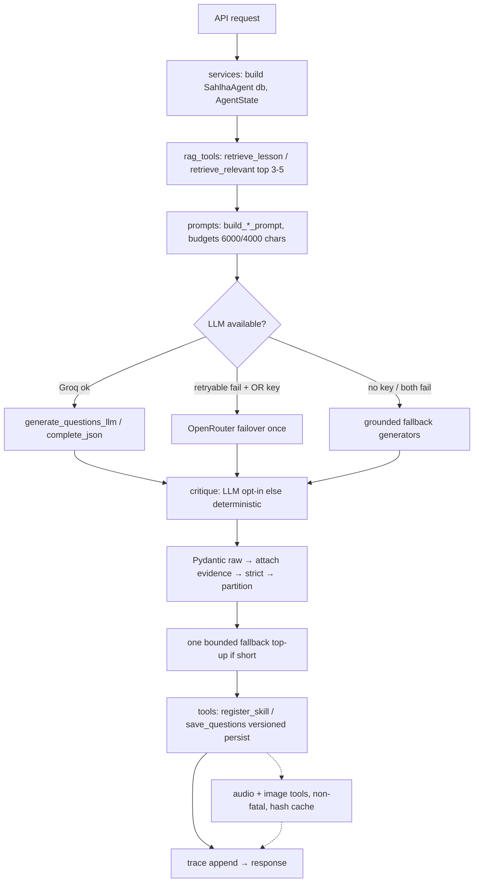

# Sahlah — Agent Analysis (first-class deployment component)

> Source: `sahlha/app/agent/*`, `sahlha/app/workflow/*`, `sahlha/app/services/*`, `sahlha/app/rag/*`.
> The agent is **not** a chatbot and **not** a LangChain/ReAct tool loop. It is deterministic Python
> orchestration; the LLM only produces text/JSON inside prompts.

## 1. Where the agent is defined and initialized

- Definition: `sahlha/app/agent/agent.py::SahlhaAgent` (~787 lines). State: `sahlha/app/agent/state.py::AgentState` + `Phase` enum (8 values).
- Construction: `SahlhaAgent(db, AgentState())` per request in `services/services.py`, `services/platform.py`, and `workflow/nodes.py` (DB via `ContextVar`, never in graph state). Caller owns the SQLAlchemy `Session`; the agent never opens its own.
- Frameworks: **custom Python state machine** (no LangChain; LangGraph only in the optional `workflow/` wrapper around the same agent methods).

## 2. Execution loop / state machine

```
SKILL_EXTRACTION → SKILL_EXPLANATION → LESSON_EXPLANATION → QUESTION_GENERATION
→ WAITING_FOR_TEACHER (hard human gate, never auto-bypassed)
→ ASSESSMENT → EVALUATION → ADAPTATION
```

- `AgentState` fields: `student_id/teacher_id/course_id/lesson_id/skill_id`, `current_phase`,
  `retrieved_context[]`, `skills[]`, `current_question_ids[]`, `current_answers{}`,
  `student_memory{history_count, performance, failed}`, `assessment_result{}`, `trace[{event, detail}]`.
- Every transition and tool call appends to `trace` (`log()`/`transition()`), surfaced in the Debug tab and API responses.
- `SahlhaWorkflowState` (LangGraph) is JSON-only: ids, counts, statuses, teacher decision, `regeneration_attempts` (max 3), trace. DB sessions/ORM rows/chunk texts never enter checkpoints.

Entry points (all synchronous Python, no streaming):

| Method | Input | Output |
|---|---|---|
| `extract_skills(course, lesson, max_skills=6, force, n_skills-alias)` | lesson scope + cap | `{skills, backend, trace, dropped, retrieved_chunks}` + `status="failed"` when zero accepted |
| `explain_skills(course, lesson, force, include_media=True)` | skills from DB | explanations persisted; media gap-filled even for existing rows |
| `explain_lesson(course, lesson, force, include_media)` | lesson scope | `{lesson_id, media, lesson}` |
| `generate_question_bank(course, lesson, skill, feedback, n=8)` | single skill | new `pending_review` bank version |
| `generate_lesson_banks(course, lesson, feedback, n=6)` | whole lesson | one bank per skill; auto-extracts+explains (media-deferred) if skills missing; `ThreadPoolExecutor(max_workers=min(6, N))` fan-out for drafts, ordered finalize+persist |
| `start_assessment(student, course?, lesson?, skill?, learned_only)` | student + scope | `{assessment_id, questions (answers stripped), lesson_explanation, skill_explanations, selection_meta, trace}` |
| `submit_assessment(assessment_id, answers)` | `{qid: int}` (≤200, unknown ids rejected, missing → incorrect) | `{score, correct, total, results[correct, correct_answer, skill_id], skills_needing_review, skill_performance}` |

## 3. Tool selection — there is none (by design)

The agent calls tools as **plain deterministic Python functions** with the DB session. No LLM tool-choice step exists.
`_generate_bank_draft` (the only worker-thread function) is pure: LLM + critique on the `job` dict, no DB.

| Tool | Input → Output | Called by |
|---|---|---|
| `rag_tools.retrieve_lesson / retrieve_relevant_material` (+ `retrieve_skill_material`, `content_tools.skill_evidence` for single-question regen) | scope/query → `[{chunk_id, text, score, course/lesson/skill/page/chunk_index}]` | extract/explain/bank jobs; one retrieval per workflow, reused for generation + evidence + validation |
| `skill_tools.register_skill / setup_skill / skill_media` | skill_data → skill dict + `has_image/has_audio` | extract/explain |
| `explanation_tools.explain_skill / explain_lesson / ensure_*_media` | text → persisted explanation + media status (`skipped` w/ reason, never raises) | setup_skill, explain paths |
| `question_tools.save_questions / get_latest_approved_questions / get_approved_questions / flag_reasons` | questions[] → `{bank_id, version, status=pending_review, num}` | generate paths; selection pool (latest-approved preferred; flagged/retired excluded) |
| `assessment_tools.select_questions / evaluate_answer / record_attempt` | pool + memory → exactly `n_per_bank=4` per bank + `meta{rationale, weak_skills, failed_retried, per_bank, flagged_excluded, covered/missing}` | start/submit |
| `student_tools.get_history / get_failed / get_performance / update_memory` | student + scope → relational memory | start/submit; scoped `(student, course, lesson, skill)`, heals legacy unscoped rows |
| `audio_tools.skill\|lesson_explanation_to_audio / envelope / prefetch` | finalized explanation → `{audio_id, path, cached}` (hash `data/audio/{sha1}.wav`, per-key locks, atomic writes) | explanation tools, routes |
| `image_tools.fetch_skill_image` | skill → cached JPEG `data/images/` + `skill.image_*` cols | explanation tools |
| `critique_tools.critique_question / critique_and_top_up / verify_question_semantically` | draft + chunks → verdicts | bank finalize (single-question regen path only for the semantic verifier) |

Chain actually wired: `skill tool → explanation tool → audio + image tools`. Question flow: agent → question tool (persistence only). Assessment flow: agent → assessment/student/question tools.

## 4. RAG interaction

- Prompts embed chunks as `[chunk <id> | skill=<…>] <text>`, truncated to `llm_max_context_chars=6000` (extraction/lesson) or `llm_skill_context_chars=4000` (skill/question).
- Search: `vectorstore.search()` — scoped DB filter (zero rows → `[]`, never leaks across lessons) → cosine over candidates → top `max(top_k*3, top_k)` → MMR λ=0.7 → dense floor 0.05 (TF-IDF floor −1 = keep all) with `picked[:1]` starvation backoff → rebuild-then-retry on cache miss → lexical overlap last resort. `retrieve_lesson` adds final scoped-DB-read backoff (`score=0.0`).
- Agent reuses the **same chunk list** for generation, `grounding.attach_*_evidence`, and `partition_*` validation. Empty retrieval → explicit `backend="empty-retrieval"`, `status="failed"`, no fabrication.
- Skill banks merge prior teacher flag reasons into prompt feedback automatically (`get_flag_reasons_for_skill`).

## 5. Skills / content generation, grounding, critique

Two-layer validation per workflow: **Pydantic raw** (`SkillList`, `GeneratedQuestion`, `SkillExplanation` ≥40 chars, `LessonExplanationModel` ≥60 chars, `QuestionList` bank rules: MCQ exactly 4 options, `correct_answer` 0–3 int, unique options, exact-dedup) → **deterministic enrichment** (`attach_*_evidence`) → **Pydantic strict** (`GroundedSkillList`, `GroundedQuestion`) → **grounding partition** (refs exist + in-scope + evidence supported + ≥2 instructional terms + not metadata). Question verdicts fail on ungrounded OR wrong-answer OR irrelevant.

Retry discipline (bounded, never loops): skills → one fallback attempt on total failure; questions → critique → schema+grounding → **one** deterministic `fallback_questions` top-up (`MAX_QUESTION_TOPUPS=1`, `MAX_SKILL_RETRIES=1`). LLM is never re-prompted. Fallbacks are grounded templates over instructional sentences (blank-keyword MCQ, rotated correct index `i%4`); all-incidental/empty input → `[]` (refuses to fabricate), except near-empty input keeps one generic placeholder so the offline loop never breaks.

Three closed feedback loops: (1) generation self-critique (deterministic default, LLM opt-in via `ENABLE_LLM_CRITIQUE`), (2) teacher-flag steering (flagged ids excluded from selection; reasons steer next generation), (3) mastery review (`skills_needing_review` <50% in-assessment; `accuracy<0.6` → weak-skill priority; `needs_review` persistent per skill).

## 6. LLM / TTS / image invocation and failure handling

- `llm.complete_json(system, user)` raises `RuntimeError("no-llm-configured")` when keyless (callers take grounded fallbacks); `generate_questions_llm` fails soft to `fallback_questions`; `critique_questions` fails soft to `fallback_critique`. Any LLM exception is logged to `trace` (`llm:*`, `validation:*`, `feedback:*`, `tool:*`, `media:*`, `assessment:*`), never silently accepted.
- Provider chain: `_call_groq` (native SDK, `timeout=60`, `max_retries=1`, temp 0.4, 2000 tokens, `json_object`) → on retryable error + OpenRouter key → **one** `_call_openrouter` failover. Note: task-specific temperatures in config (0.15/0.4/0.3) are stored but the current `_call_llm` path does not thread them per call (verified discrepancy — harmless, do not "fix" silently).
- TTS: `synthesize()` Groq chunks → WAV stitch → on retryable TTS error + OR key → OpenRouter path (mp3 then pcm candidates, `troy→alloy` voice remap). Media failures never fail explanations (`status=skipped`).
- Timeouts observed: groq 60s, provider-level 45s (`PROVIDER_TIMEOUT_SECONDS`), client hints 120–300s for upload/extract/generate/audio/image.

## 7. State, persistence, and async behavior

- **State persists between stages in the DB, not in the agent.** `AgentState` is per-call and serializable; "memory" is relational (`StudentAttempt`/`StudentSkillPerformance` read fresh per assessment; no vector memory, no conversation history). Submit batches all `record_attempt(commit=False)` + `update_memory(commit=False)` then commits once.
- **Async:** `ThreadPoolExecutor` fan-out for LLM drafts (no-DB half) + `BackgroundTasks` for index rebuild/audio prefetch. No `asyncio`, no streaming, no queue, no durable execution. LangGraph `MemorySaver` is the only "durable" piece and it is **not** durable across restarts.
- **Local resources:** embedding singleton (~90MB, ~9s cold load, lifespan-warmed), `vectors.npz` cache, `data/uploads|audio|images`, SQLite WAL-not-required single-writer.
- **Native/library constraints:** torch/`sentence-transformers` (heavy, optional), `scikit-learn`/`numpy` (light), Tesseract + Poppler **binaries** (OS-level, in `Dockerfile`, impossible on Workers V8 isolates), `pypdf`/`python-docx`/`Pillow` (pure). No GPU needed.

## 8. Per-operation deployment profile

| Operation | CPU / net / duration | Sync? | Persistent state? | On failure |
|---|---|---|---|---|
| Upload + extract + chunk + persist | Light + OCR spike; 25MB cap | Sync (fast return; index deferred) | Document + chunks + raw bytes | `ValueError` (empty/oversize) → 4xx; OCR failure → `ocr:failed/unavailable`, never crashes |
| `rebuild_index` | CPU-heavy (dense full ~40s/1700; incremental ~0.03s) | **Async** (`BackgroundTasks`) | `vectors.npz` cache | Retrieval falls back to keyword ranking; platform path marks `processed` only after indexing |
| `extract_skills` | 1 retrieval + 1 LLM call | Sync | Skills + lesson category | `empty-retrieval`/`failed`, or bounded fallback retry |
| `explain_skills/lesson` | N+1 LLM calls + media fan-out | Sync (threaded) | Explanations + media cache | Media `skipped`; explanation persists |
| `generate_*_banks` | N LLM drafts (threaded) + critique/top-up + versioned persist | Sync (longest; minutes) | New `pending_review` versions (append-only; concurrent version retry ×3) | Empty bank as observable failure, never padded |
| Teacher approve/reject/flag/edit/regen | Light DB writes | Sync | Bank status, `QuestionFeedback`, counters | Blocked edits on approved banks (regenerate instead); max 3 LangGraph regenerations → `needs_teacher` |
| `start_assessment` | Retrieval-free (DB pool + memory reads) | Sync | `Assessment(started, question_ids, selection_meta)` | `SelectionError/ValueError` on empty pool / all-flagged / thin bank (`need 4, have K`) |
| `check` (per-question) + `submit` | Deterministic compare + batched writes | Sync | Locked attempts + scoped counters + mastery | Double-submit → 400; malformed → schema reject |
| TTS/image | Network, chunked | Sync-on-demand + background prefetch | Hash/disk cache + `skill.image_*` | `503` without keys; explanation unaffected |

## 9. What the agent requires to run (compatibility assessment)

- [x] **Conventional persistent Python runtime** — required. Single process, threads, local disk, ~9s model load, multi-minute teacher generations, in-memory singletons. This is the load-bearing constraint behind the hosting recommendation.
- [x] **Background execution (light)** — required in current form (`BackgroundTasks` + threads). No Celery/Redis needed for MVP; a queue (Cloudflare Queues) is only justified if OCR/embedding outgrows the container (Stage 2, optional).
- [ ] **Durable execution / workflow recovery** — not required today. LangGraph pauses are in-memory; teacher runs are short enough to re-run. Do not add Cloudflare Workflows until a real cross-restart resume requirement exists.
- [ ] **Streaming** — not implemented, not needed (assessments are request/response; audio is file download).
- [x] **Shared storage + DB access** — required: SQLite file + `data/*` in one volume (demo) → Postgres + R2 in production (Stage 2).
- [x] **Retry/idempotency** — partially built-in (idempotent extract unless `force`, media gap-fill, version retry, bounded top-ups). Needs production hardening (idempotency keys on upload/generate, DLQ if Queues added) — Stage 3.



**Preservation rule:** do not replace this agent with Workers AI / AI Search / AutoRAG, and do not rewrite it in JS/TS for Workers. Those are complements at most (e.g. Workers AI embeddings for a future Vectorize migration) with migration costs documented in `cloudflare-service-mapping.md`. The existing tool behavior, provider fallbacks, deterministic fallbacks, and approval gate must be preserved unless explicitly approved.
