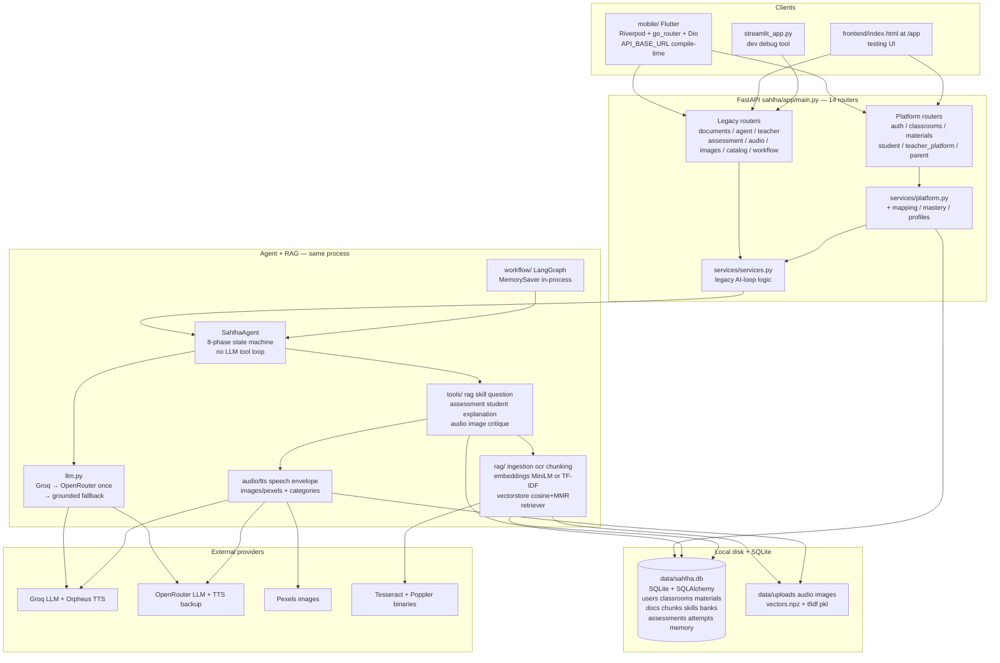
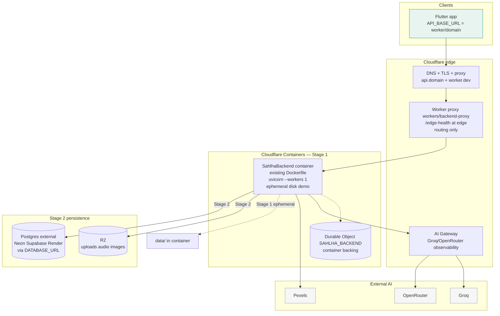
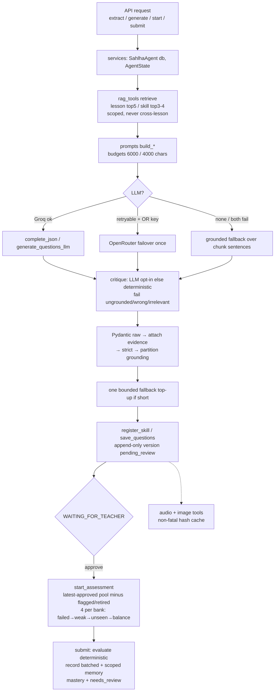

# Sahlah — Architecture Diagrams (Mermaid)

> All diagrams render in standard Markdown/Mermaid viewers. They reflect verified code, not aspirational infra.

## 1. Current architecture (as-built)

## 2. Proposed deployment architecture (Stage 1 demo → Stage 2 production)

Legend: solid = Stage 1 path; dashed-labeled = Stage 2 additions. Synchronous request paths are solid arrows; async work (`BackgroundTasks` index rebuild, audio prefetch) stays **inside** the container (no separate queue in Stage 1).

## 3. Agent execution flow

## 4. Document ingestion and RAG workflow (implemented vs planned)

Implemented (solid) vs planned/deferred (dashed):

```mermaid
flowchart LR
  UP[Teacher/parent upload<br/>PDF DOCX TXT MD image<br/>25MB cap + ext allowlist] --> VG[validate + sanitize name]
  VG --> EX[extract_document_text<br/>pypdf/docx/txt native<br/>Tesseract+Poppler if scanned]
  EX --> LS[derive lesson_id<br/>explicit > title line > filename]
  LS --> CH[chunk_text 800/120<br/>sentence-aware + overlap]
  CH --> PS[persist Document + Chunks<br/>course/lesson/skill/page/index]
  PS --> IX{index}
  IX -- HTTP path --> BG[BackgroundTasks rebuild_index<br/>incremental dense or TF-IDF refit]
  IX -- tests/sync path --> SY[synchronous rebuild]
  BG --> VS[vectors.npz cache<br/>ids matrix backend]
  SY --> VS
  VS --> RT[search: cosine → MMR 0.7<br/>→ floor 0.05 → backoff → lexical]
  RT --> AG2[agent pulls per phase<br/>same chunks for gen + evidence]
  AG2 --> SK[skills → explanations → banks]
  SK --> TG[teacher approve/reject/flag<br/>append-only versions]
  TG --> ST[student study + assess<br/>answers stripped]
  ST -.-> VZ[Vectorize migration<br/>deferred]
  ST -.-> Q[Queues for OCR/index<br/>deferred]
```

Verified implemented: steps UP→ST (including PPTX caveat: no dedicated parser — falls to raw decode).
Deferred (not in code): Vectorize, Queues/Workflows for ingestion, reranker wiring, `LearningContent` visuals.
